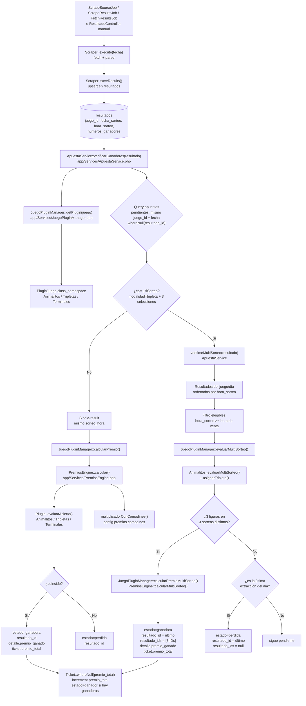
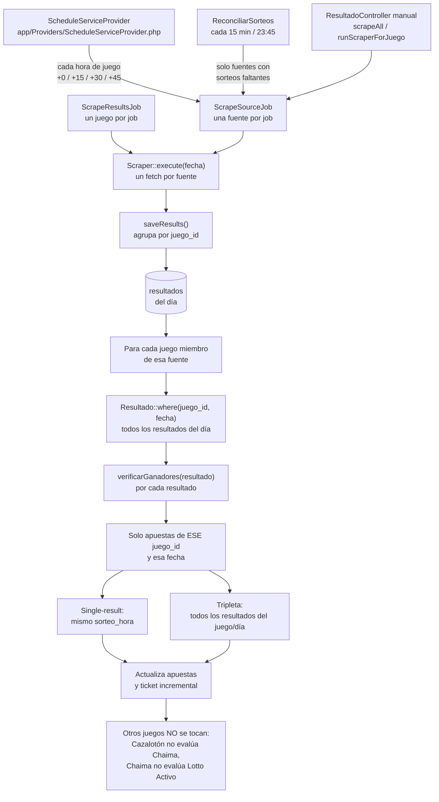

# Arquitectura del backend (Laravel)

> Mapa de referencia del backend: qué hace cada carpeta, cómo está organizado
> `app/`, y cómo funcionan el **motor de premios** y el **motor de búsqueda de
> resultados** de punta a punta.
>
> Complementa a [`estructura.md`](estructura.md) (mapa del monorepo) y a
> [`motor-premios.md`](motor-premios.md) (reglas de cálculo y operación del
> motor de premios). Los pendientes viven en [`pendientes-front.md`](pendientes-front.md).

## 1. Visión general

Backend **Laravel 13 con API pura** (PHP 8.3+). No renderiza vistas de negocio:
todo se expone como JSON bajo `/api/v1`. Dependencias clave (`composer.json`):

| Paquete | Rol |
|---|---|
| `laravel/sanctum` | Autenticación por tokens |
| `spatie/laravel-permission` | Roles y permisos |
| `laravel/horizon` | Colas sobre Redis (scraping asíncrono) |
| `guzzlehttp/guzzle` | Cliente HTTP de los scrapers |
| `symfony/dom-crawler` + `css-selector` | Parseo de HTML de los sitios de lotería |

Es el cerebro de un sistema de loterías: recibe apuestas, guarda resultados de
sorteos (obtenidos por scraping), calcula premios, y maneja la jerarquía
banca/grupo/taquilla/agencia con comisiones y cierres de caja.

## 2. Carpetas en la raíz de `backend/`

### 2.1 Estándar de Laravel

| Carpeta / archivo | Para qué sirve |
|---|---|
| `app/` | Código de la aplicación (ver §3) |
| `bootstrap/` | Arranque del framework. `app.php` configura routing, middlewares y excepciones; `providers.php` lista los service providers |
| `config/` | Configuración por archivo (`app.php`, `auth.php`, `database.php`, `queue.php`, `sanctum.php`, `cors.php`, …) |
| `database/` | Migraciones (~50 tablas), seeders (los 21 juegos) y factories |
| `public/` | Document root: `index.php` (front controller), `favicon.ico`, `robots.txt` |
| `resources/` | `views/admin` (vista Blade mínima del panel de resultados), `css`/`js` para Vite |
| `routes/` | `api.php` (negocio, `/api/v1`), `web.php` (panel admin), `console.php` (scheduler + comandos) |
| `storage/` | Logs, caché, sesiones, temporales |
| `tests/` | `Feature/` (integración por endpoint/job) y `Unit/` (scrapers, plugins, engine). `Fixtures/` con HTML/JSON reales |
| `vendor/` | Dependencias Composer |

### 2.2 Propias del proyecto (o customizadas)

| Archivo / carpeta | Por qué es del proyecto |
|---|---|
| `docs/`, `rutas.md` | Documentación: catálogo de juegos y superficie de la API |
| `Dockerfile`, `entrypoint.sh` | Empaquetado y arranque: el entrypoint decide si el contenedor corre API, Horizon o scheduler, y solo la API migra |
| `.env*` | Configuración por entorno |
| `bootstrap/app.php` | Forzado a JSON puro (`shouldRenderJsonWhen(fn () => true)`), registra los alias `role`, `permission`, `checkrole`, `verify.mac` y el render de errores 401/403/404 |
| `config/iconos-animales.php` | Config de negocio (iconos de los animales) |
| `config/permission.php` | Config de spatie usada por la jerarquía real de roles |

## 3. `app/` a detalle

| Subcarpeta | Origen | Contenido |
|---|---|---|
| `Console/Commands/` | Negocio | `resultados:reconciliar`, `resultados:metricas`, `juegos:export`, `ScrapeExchangeRate`, `AgenciasBackfill`, `TaquillasSanearActivas`, `ReleasePublishCommand` |
| `Http/Controllers/Api/` | Negocio | ~22 controladores delgados (`ApuestaController`, `TicketController`, `ResultadoController`, `JuegoController`, `CierreController`, `ComisionController`, …): validan, autorizan y delegan en `Services` |
| `Http/Controllers/Admin/` | Negocio | Panel admin interno (Blade mínimo + scraping manual legado) |
| `Http/Middleware/` | Negocio | `VerifyMac` (huella MAC del dispositivo de taquilla), `CheckRole` |
| `Http/Requests/` | Negocio | `ApuestaStoreRequest`: pide las reglas de validación **al plugin del juego**, así la forma de `combinacion` cambia por tipo de juego |
| `Jobs/` | Negocio | `ScrapeSourceJob` (canónico, por fuente), `ScrapeResultsJob` (por juego, legado), `FetchResultsJob` (legado animalitos), `ScrapeExchangeRateJob`, `ExpireUnclaimedPrizesJob`, `MarcarApuestasVencidasJob` |
| `Models/` | Negocio | Eloquent de dominio (`Apuesta`, `DetalleApuesta`, `Ticket`, `Juego`, `JuegoOpcion`, `JuegoHorario`, `JuegoLimite`, `Resultado`, `Pago`, jerarquía `Banca`/`Grupo`/`Agencia`/`Taquilla`, `ComisionDefault`, `CierreCaja`, …) |
| `Plugins/Contracts/` | Negocio | `JuegoInterface` |
| `Plugins/Juegos/` | Negocio | `Animalitos`, `Terminales`, `Tripletas` (plugins de **juego**) |
| `Plugins/Scrapers/` | Negocio | `BaseScraper` + ~18 scrapers concretos (`LoteriaDeHoyScraper`, `LaGranjitaScraper`, `TripleCalienteOficialScraper`, …) |
| `Policies/` | Convención + negocio | `ApuestaPolicy` |
| `Providers/` | Mixto | `AppServiceProvider` (estándar); `PluginServiceProvider` y `ScheduleServiceProvider` (negocio) |
| `Services/` | Negocio | Corazón: `PremiosEngine`, `ApuestaService`, `JuegoPluginManager`, `PremiosConfigService`, `ScraperSourceResolver`, `ScraperSource`, `DrawReconciliationService`, `CierreService`, `ComisionService`, `ConfiguracionService`, `JuegoLimiteService`, `JuegoCatalogoService`, `ActivacionEfectivaService` |
| `Support/` | Negocio | `PremiosOficiales` (catálogo en código de los 21 juegos), `Texto` (normalización) |

### 3.1 Nota clave: hay DOS sistemas de plugins

Comparten `app/Plugins/` pero no tienen relación entre sí:

| | Plugins de **Juego** | Plugins de **Scraper** |
|---|---|---|
| Carpeta | `Plugins/Juegos/` | `Plugins/Scrapers/` |
| Contrato | `JuegoInterface` | `BaseScraper` (abstracta) |
| Registro | Tabla `plugin_juegos.class_namespace` | **Sin registry**: `juegos.scraper_class` + heurística de URL + convención de nombre |
| Resuelve | `JuegoPluginManager` | `ScraperSourceResolver` |
| Decide | **Forma** del acierto y validación | **De dónde y cómo** se obtiene el dato |

Ninguno de los dos decide el **dinero**; eso es exclusivo de `PremiosEngine`.

## 4. Motor de premios

**Idea central**: el **plugin decide la FORMA** (¿coincidió?, ¿con qué
modalidad?) y el **`PremiosEngine` decide el DINERO** (qué multiplicador).
Ningún plugin hardcodea multiplicadores; viven en `juegos.config.premios`.

### 4.1 Archivos que participan

```
app/Services/PremiosEngine.php        ← traduce clave → multiplicador
app/Services/ApuestaService.php       ← registra y liquida
app/Services/JuegoPluginManager.php   ← puente a plugins
app/Support/PremiosOficiales.php      ← catálogo de premios
app/Support/Texto.php                 ← normalización
app/Plugins/Contracts/JuegoInterface.php
app/Plugins/Juegos/{Animalitos,Terminales,Tripletas}.php
app/Models/{Apuesta,DetalleApuesta,Juego,JuegoOpcion,Resultado}.php
```

### 4.2 Flujo A — Registrar una apuesta (venta)

```
POST /api/v1/apuestas
  → ApuestaController::store
    → ApuestaStoreRequest::rules()      // pide reglas al plugin del juego
    → ApuestaService::createApuesta()
```

`createApuesta()` en orden:
1. Verifica tasa de cambio activa.
2. Valida moneda/límites (`JuegoLimite`) y costo mínimo.
3. `JuegoPluginManager::getPlugin()` → **guard**: juego inactivo o sin plugin → rechaza la venta.
4. Carga opciones reales (`juego_opciones`) y valida la combinación con `$plugin->validarApuesta()`.
5. Valida que una `combinacion.modalidad` declarada exista en `config.premios.modalidades` (reemplaza el antiguo `PremiosEngine::premioPosible()`).
6. Crea `Apuesta` (estado `pendiente`) + `DetalleApuesta` con **`premios_snapshot`** = la config de premios del momento de venta. No existe `premio_posible`.
7. Crea el `Pago` (ingreso).

El **snapshot** congela la config de premios: editar premios después NO altera
los tickets ya vendidos (sin retroactividad).

### 4.3 Flujo B — Liquidar cuando llega el resultado

```
Resultado guardado
  → ApuestaService::verificarGanadores($resultado)
    → JuegoPluginManager::calcularPremio()
      → PremiosEngine::calcular()
```

`PremiosEngine::calcular()`:
1. Juego inactivo → 0.
2. `$plugin->evaluarAcierto(...)` → `{coincide, clave, meta}` (la FORMA).
3. Sin coincidencia → 0.
4. `multiplicadorConComodines($juego, $clave, $meta, $premios)` → busca en `config.premios.modalidades[clave]` y aplica comodines.
5. `premio_bs = round(amount_bs × mult, 2)`, y análogo para USD.

`verificarGanadores()` marca la apuesta `ganadora`/`perdida`, escribe
`DetalleApuesta.premio_ganado` y **acumula** el total en el Ticket.

Para la **tripleta multi-sorteo** (Cazalotón / Loto Chaima), `verificarGanadores()` delega en
`verificarMultiSorteo()`: evalúa la apuesta contra todos los resultados del juego/día, exige 3 figuras
distintas en 3 sorteos distintos y guarda la evidencia en `apuestas.resultado_ids`. La última extracción
del día marca las pendientes como `perdida`. El detalle completo está en la sección 8.

### 4.4 Comodines

- `flag` / `letra` / `numero` → **reemplazan** el multiplicador (gana el mayor).
- `palabra` + `acumulativo` → **suman** (`Patronus 75`: 120 + 20 = 140×).
- **Selva Plus**: el comodín A/B es una figura apostable independiente. El sorteo con comodín no trae
  `nombre_animal`; solo gana la apuesta al comodín (`comodin-a`/`comodin-b`, `Leoncito`, `Selva Plus` o
  su label). Una apuesta a un animal pierde en ese sorteo.

### 4.5 `PremiosOficiales`

Fuente de verdad en código de los premios de los 21 juegos. `configPara($slug)`
construye el objeto que se escribe en `juegos.config` (lo usan los seeders y la
migración de backfill), y mantiene los espejos legacy (`premio_multiplo`,
`modalidades`) que consume `docs/juegos.json`.

## 5. Motor de búsqueda de resultados (scraping)

### 5.1 Archivos que participan

```
app/Plugins/Scrapers/*                 ← cómo bajar/parsear
app/Services/ScraperSourceResolver.php ← resuelve fuente y clase
app/Services/ScraperSource.php         ← DTO de fuente
app/Jobs/{ScrapeSourceJob,ScrapeResultsJob,FetchResultsJob}.php
app/Providers/ScheduleServiceProvider.php ← el calendario
app/Console/Commands/ReconciliarSorteos.php
app/Services/DrawReconciliationService.php
app/Models/{Resultado,Juego,PluginJuego}.php
```

### 5.2 Calendario (data-driven)

`ScheduleServiceProvider::boot()` lee la BD en cada arranque y registra, por
**fuente × hora de sorteo × offset `[0,15,30,45]`**, un `ScrapeSourceJob`. Son
4 pasadas retardadas por sorteo, con guarda en el job. Agregar un juego u
horario no requiere tocar código, solo la BD.

```
schedule:work  → hora/+15/+30/+45 → ScrapeSourceJob ─ ¿faltan sorteos? → skip
               → cada 15 min       → resultados:reconciliar → ScrapeSourceJob
               → 23:45             → resultados:reconciliar --day-close
```

### 5.3 `ScrapeSourceJob::handle()`

1. `ScraperSourceResolver::sourceByKey(key)` → fuente (clase + juegos agrupados).
2. Guarda `debeEjecutar()` → solo continúa si falta algún sorteo programado de esa hora.
3. `$scraper->execute($fecha)` → `fetch()` (HTTP) → `parse()`.
4. `$scraper->saveResults()` → `updateOrCreate` por `(juego_id, fecha_sorteo, hora_sorteo)`.
5. Por cada resultado: `ApuestaService::verificarGanadores()` (conecta con el motor de premios).
6. Log en la tabla `logs`.

### 5.4 Resolución de fuente y clase

- **Clase de scraper** (precedencia): `juegos.scraper_class` → heurística de URL → convención por `type` (`{Type}Scraper`).
- **Clave de fuente**: la familia Lotto Activo (Lotto Activo, RD, RD SD, Monje) se agrupa en `lottoactivo-animalitos` → **un fetch cubre 4+ juegos**. El resto = una fuente por juego (`slug`).

### 5.5 Reconciliación y dedupe

- `DrawReconciliationService` cruza `juego_horarios` (esperados) vs `resultados` (persistidos) y detecta huecos. **No toca apuestas.**
- `resultados:reconciliar` (cada 15 min) despacha solo por fuentes con huecos; `--day-close` (23:45) barre el día completo.
- Índice único `(juego_id, fecha_sorteo, hora_sorteo)` + `updateOrCreate`.
- Anti doble liquidación: `whereNull('resultado_id')` en `verificarGanadores`.

## 6. Cómo se conectan los dos motores

```
                    VENTA (síncrono)
  HTTP → Http/Controllers → Services/ApuestaService ─┐
                                     │                │
                                     ▼                ▼
                        Plugins/Juegos (FORMA)   Services/PremiosEngine (DINERO)
                                     │                │
                                     └────► Models/DetalleApuesta (premios_snapshot)

                LIQUIDACIÓN (asíncrono)
  Scheduler → Jobs/ScrapeSourceJob → Plugins/Scrapers (obtiene dato)
                                   → Models/Resultado (persiste)
                                   → Services/ApuestaService::verificarGanadores
                                      → Services/JuegoPluginManager
                                         → Plugins/Juegos  (evaluarAcierto → clave)
                                         → Services/PremiosEngine (clave → multiplicador)
                                            → Models/{Apuesta,DetalleApuesta,Ticket}
```

## 7. Gotchas

1. **Dos sistemas de plugins** con el mismo nombre (`Juegos` vs `Scrapers`) y mecanismos de registro distintos.
2. **`PluginServiceProvider` casi no se usa en runtime**: `JuegoPluginManager` lee la tabla `plugin_juegos`. No te guíes por el singleton `'plugins'`.
3. **`calcularPremio`/`obtenerMultiplicador` en los plugins están `@deprecated`** (legacy decorativo); el dinero real sale de `config.premios`.
4. **`DrawReconciliationService` no reconcilia apuestas**, solo sorteos.
5. **`config/scraper.php` no existe** → los scrapers que leen `config('scraper.product_id', …)` siempre caen al default; los demás usan `juego.config['scraper']['product_id']` (que sí existe por seeder).
6. **`hora_sorteo` no está en `$casts`** de `Resultado` (es string); el formato se normaliza a `H:i` antes del upsert.

---

## 8. Flujo detallado: evaluación de resultados y tripleta multi-sorteo (issue #63)

> Esta sección documenta el camino real desde que un scraper persiste un resultado hasta que se actualizan
> las apuestas y el ticket. Incluye el caso multi-sorteo de la tripleta (Cazalotón / Loto Chaima).

### 8.1 Qué pasa cuando llega un resultado



**Notas del flujo:**

- `verificarGanadores()` separa **single-result** (mismo juego, fecha y hora exacta) de **multi-sorteo**
  (mismo juego y fecha, sin hora exacta).
- Las tripletas se re-evalúan en cada resultado nuevo del día mientras sigan `pendiente`
  (`resultado_id` null). Al ganar o perder se les asigna `resultado_id` y no se reprocesan.
- El dinero siempre lo decide `PremiosEngine`; el plugin solo devuelve `coincide`, `clave` y `meta`.

### 8.2 Qué tickets se evalúan cuando llega un scraper



**Qué significa “evalúa los tickets de ese día”:**

- No se evalúan todos los tickets ni todos los juegos. Se evalúan las **apuestas pendientes del juego
  cuyo resultado llegó**, para la fecha del resultado.
- `ScrapeSourceJob` obtiene una **fuente** (por ejemplo `lottoactivo-animalitos`), que puede contener
  varios juegos que comparten feed: Lotto Activo, RD, RD Rep. Dom., Monje. Guarda cada resultado con su
  `juego_id` y luego evalúa las apuestas de cada juego miembro.
- `ScrapeResultsJob` trabaja **un juego** por job.
- `FetchResultsJob` es el camino legacy: usa `AnimalitosScraper` sobre el feed completo de animalitos y
  evalúa todos los resultados de la fecha que devolvió ese feed.
- `verificarGanadores()` **no recorre todos los juegos**: filtra `where('juego_id', $resultado->juego_id)`.
- Un ticket puede tener apuestas de varios juegos. Cuando llega el resultado de Lotto Activo, solo se
  actualiza la apuesta de Lotto Activo de ese ticket; la de Cazalotón sigue pendiente hasta que llegue
  su propio resultado.
- El estado del ticket se actualiza de forma incremental: `premio_total_*` se acumula y el ticket pasa a
  `ganador` si alguna de sus apuestas ganó. No se recalcula el ticket completo desde cero.

### 8.3 `evaluarMultiSorteo()` y `asignarTripleta()` no son el mismo código

| Función | Tipo | Rol |
|---|---|---|
| `Animalitos::evaluarMultiSorteo()` | pública | Punto de entrada: valida 3 selecciones, arma candidatos del día y llama al matcher. |
| `Animalitos::asignarTripleta()` | privada, recursiva | Backtracking que asigna cada selección a un sorteo distinto. |

La cadena es:

```text
Animalitos::evaluarMultiSorteo()
  → valida 3 selecciones distintas
  → construye $candidatos: [{id, nombre_animal, clave}]
      clave = hora_sorteo (o "id:N" si no hay hora)
  → asignarTripleta($buscados, $candidatos, 0, [])
       → si ya usó una clave, no la repite
       → si el nombre coincide, asigna y sigue con la siguiente selección
       → si no hay salida, retrocede
  → devuelve meta.resultado_ids en el orden de las selecciones
```

El “no reutiliza la misma hora de sorteo” vive en `asignarTripleta()`: `$usados` guarda la **clave del
sorteo** (la hora, o el ID si no hay hora), no la posición del array.

### 8.4 ¿Cuándo se marca perdida una tripleta?

**Hoy no se marca perdida cuando pasan los primeros 3 sorteos después de la venta.** La tripleta tiene
3 animales, no 3 horarios elegidos:

- Puede acertar en **cualquier combinación de 3 sorteos distintos posteriores a la venta**, hasta la
  última extracción del día.
- El código actual solo la marca `perdida` cuando el resultado procesado es **la última extracción
  programada del día** (`$esUltima`).
- Si pasan los primeros 3 sorteos y no acertó los 3, la apuesta **sigue pendiente** y puede ganar en
  sorteos posteriores.
- Si el último resultado del día nunca llega, queda pendiente y el job de vencimiento la marca `vencido`
  a las 24 h.
- La venta exige `sorteosFuturos >= 3`; eso garantiza que al vender haya al menos 3 extracciones
  posibles, pero **no limita** la apuesta a esas 3.

Mejora posible (no implementada): marcarla perdida antes cuando sea matemáticamente imposible, por
ejemplo `faltantes > sorteosRestantes` del día.

### 8.5 Disparadores del settlement

| Disparador | Archivo | Alcance |
|---|---|---|
| Scheduler por fuente/hora | `app/Providers/ScheduleServiceProvider.php` | `ScrapeSourceJob` por fuente, 4 pasadas por hora |
| Reconciliación | `app/Console/Commands/ReconciliarSorteos.php` | Fuentes con sorteos esperados-faltantes; cierre 23:45 |
| Scrape por juego | `app/Jobs/ScrapeResultsJob.php` | Un juego, fecha; dedupe por fecha/hora |
| Scrape legacy | `app/Jobs/FetchResultsJob.php` | Feed completo de animalitos |
| Manual API | `app/Http/Controllers/Api/ResultadoController.php` | Por fuente o por juego |
| Catch-up de vencimiento | `app/Jobs/MarcarApuestasVencidasJob.php` | Relanza `ScrapeResultsJob` antes de vencer |
| Pago/consulta | `PagoController`, `TicketController::ganadores` | No hacen settlement; leen o recalculan con evidencia |

### 8.6 Terminología: “llega un scraper” vs “llega un resultado”

No son lo mismo, aunque coloquialmente se usen como sinónimos:

| Expresión | Significado preciso |
|---|---|
| “Llega un scraper” | El **job** del scraper corrió (`ScrapeSourceJob`, `ScrapeResultsJob` o `FetchResultsJob`) y ejecutó `Scraper::execute()` + `saveResults()`. |
| “Llega un resultado” | Ya existe una fila `resultados` persistida para un `juego_id`, `fecha_sorteo` y `hora_sorteo`; ese es el disparador real de `verificarGanadores()`. |

Secuencia real:

```text
Job del scraper
  → Scraper::execute(fecha)        (fetch + parse)
  → Scraper::saveResults()         (upsert de N filas en resultados)
  → por cada Resultado del día
      → ApuestaService::verificarGanadores(resultado)
          → evalúa apuestas de ESE juego_id + fecha
              → single-result: mismo sorteo_hora
              → tripleta: todos los resultados del juego/día
          → actualiza Apuesta/DetalleApuesta/Ticket
```

Consecuencias:

- Un solo scraper puede persistir **muchos resultados** (varias horas y varios juegos de la misma fuente).
  Cada resultado se evalúa por separado.
- Un ticket **no se evalúa completo**: se evalúan sus apuestas del juego/fecha que corresponde al
  resultado. Las apuestas de otros juegos del mismo ticket siguen pendientes.
- Los jobs de scraping vuelven a recorrer **todos los resultados del día** después de un fetch exitoso,
  no solo los nuevos. Eso permite que una tripleta pendiente se complete con un resultado posterior.
  Las apuestas single-result ya liquidadas se saltan por `whereNull('resultado_id')`.
- Si el scraper no devuelve resultados, el job retorna antes de evaluar (`empty($resultados)`), así que
  “correr el scraper” sin datos no dispara evaluación.

### 8.7 ¿Se puede prescindir de `FetchResultsJob`?

**Sí, pero no en este cambio.** `FetchResultsJob` es el job legacy que usa `AnimalitosScraper` sobre el
feed completo de lottoactivo.com y evalúa todos los resultados de la fecha.

Uso actual verificado:

| Uso | Archivo | ¿Producción? |
|---|---|---|
| Ruta web legacy `POST /admin/resultados/scrape` | `app/Http/Controllers/Admin/ResultadoController.php:40` | Solo panel admin legacy |
| Test | `tests/Feature/FetchResultsJobTest.php` | Test |
| Scheduler | — | **No**; el scheduler usa `ScrapeSourceJob` por fuente/hora |
| API manual | `ResultadoController` API | **No**; usa `ScrapeSourceJob` / `ScrapeResultsJob` |

Conclusión:

- El camino nuevo (`ScrapeSourceJob` + `ScrapeResultsJob`) cubre el mismo feed y además otros juegos.
- `FetchResultsJob` solo se usa desde el panel admin web legacy, que es el alcance del issue #81
  (“eliminar el panel web legacy”).
- Por eso conviene eliminarlo **junto con #81**: quitar la ruta `resultados.scrape`, el método
  `Admin\ResultadoController::scrape`, el job y su test. Hacerlo en #63 mezclaría un cambio de dominio de
  premios con la retirada del panel legacy.
- Si el panel legacy se queda, `FetchResultsJob` debe quedarse; si se retira, el job queda huérfano.
