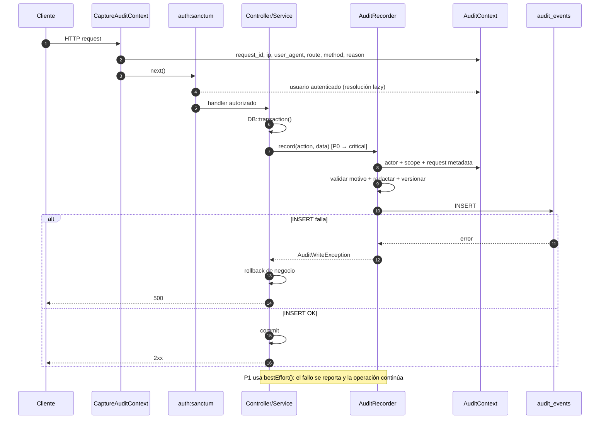
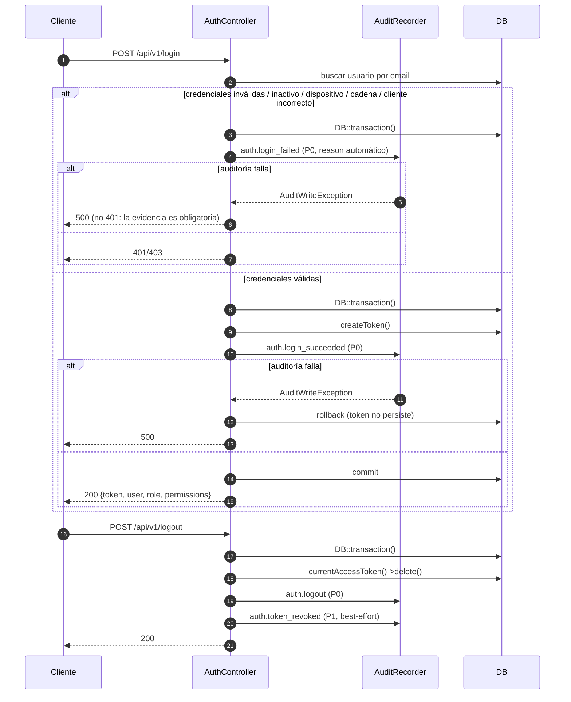
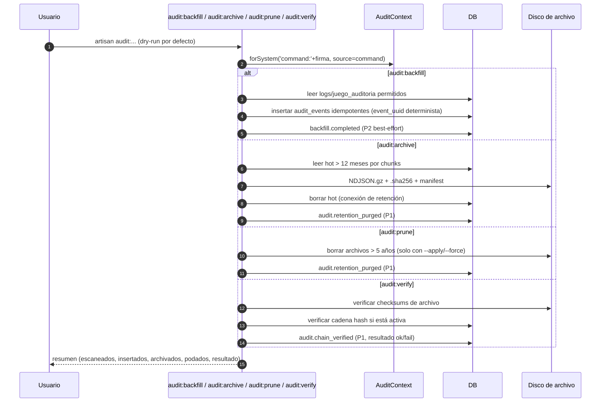

# Design: Auditoría y trazabilidad (#89)

**Cambio**: `auditoria-trazabilidad-89` · Issue [#89](https://github.com/jmxsdev/lotto-app/issues/89)
**Base**: `main` @ `ea7d381` · **Rama tracker**: `feature/auditoria-trazabilidad-89`
**Tienda de artefactos**: OpenSpec + Engram (`sdd/auditoria-trazabilidad-89/design`)
**Estrategia**: `feature-branch-chain` · **Presupuesto de revisión**: 800 líneas por WU/PR
**Estado**: diseño técnico; no implementa código ni ejecuta comandos.

## 0. Resumen

| Pregunta | Respuesta |
|---|---|
| ¿Dónde vive la evidencia? | Tabla nueva `audit_events`, append-only; `logs` queda como log operativo. |
| ¿Cómo se captura? | `AuditContext` + `AuditRecorder` + trait `Auditable` opt-in + llamadas explícitas; sin observer global. |
| ¿Qué pasa si falla la escritura? | P0 falla cerrado dentro de la transacción de negocio; P1 es best-effort; sin outbox. |
| ¿Cómo se lee? | `GET /api/v1/audit-events` + `/export`, `view_audit`/`export_audit`, cursor pagination y scope `AlcanceService`. |
| ¿Cómo se conserva? | 12 meses hot + 5 años en NDJSON comprimido con checksum; grants/triggers en BD y hash chain opcional. |
| ¿Qué queda fuera? | Login del admin legacy y `FetchResultsJob` (#81 los retira); `bootstrap/app.php`; observer global. |

El diseño es **aditivo**: no cambia el modelo de negocio salvo donde una acción P0 debe escribir evidencia dentro de su transacción. Cada WU se puede revertir sin deshacer las demás.

## 1. Contexto y restricciones

### 1.1 Plataforma y alcance

- Laravel 13 / PHP 8.3, API `/api/v1`, Sanctum, Spatie Permission, Horizon, MySQL en producción.
- Panel Astro (`panel/`) sin framework reactivo; DOM directo y `apiFetch`.
- Zona horaria de la app: `America/Caracas`; `audit_events.occurred_at` se persiste y expone en **UTC**.
- Solo se audita el flujo de **operadores API** y los **jobs de sistema**.
- El admin legacy (`routes/web.php`, `app/Http/Controllers/Admin/**`, `resources/views/**`) y
  `FetchResultsJob` están **fuera de alcance**: #81 los retira y este ciclo no los toca.

### 1.2 Conflicto con `retiro-legacy-backend`

| Archivo / área | Ciclo legacy | Este ciclo |
|---|---|---|
| `backend/routes/web.php` | Borra | **No tocar** |
| `backend/app/Http/Controllers/Admin/**` | Borra | **No tocar** |
| `backend/resources/views/**`, `welcome.blade.php` | Borra | **No tocar** |
| `backend/app/Jobs/FetchResultsJob.php` | Borra | **No tocar** |
| `backend/bootstrap/app.php` | Modifica | **No tocar** |
| `backend/app/Http/Middleware/CheckRole.php` | Ya borrado | **No tocar** |
| `docs/dev/estructura.md`, `arquitectura-backend.md`, `plugins.md`, `auditoria-logs.md` | Modifica | **No tocar** |
| `backend/tests/Feature/BackendSurfaceTest.php` | Crea | **No tocar** |
| `backend/routes/api.php`, `app/Http/Controllers/Api/**`, `app/Services/**`, `app/Models/**`, `database/migrations/**`, `panel/**`, `tests/Feature/Auditoria*` | — | **Compartidos seguros** |

Reglas duras derivadas:

1. El middleware de contexto se registra **directamente en `routes/api.php`** por referencia de clase,
   no en `bootstrap/app.php` ni con alias.
2. No se crea un observer global de Eloquent.
3. El login legacy y `FetchResultsJob` no se auditan ni se referencian.
4. `docs/dev/auditoria-sistema.md` es el documento nuevo; `auditoria-logs.md` se reconcilia después del merge legacy.
5. Si `retiro-legacy-backend` mergea primero, se sincroniza `main` en la tracker y se resuelve solo lo propio.

### 1.3 Protocolo de trabajo

- El agente implementa una WU y **no ejecuta** tests, migraciones, Pint, composer, npm ni artisan.
- El usuario ejecuta los comandos de la §11 y reporta pass/fail.
- Commits locales por WU; sin push hasta el cierre del ciclo.
- Presupuesto: 800 líneas por WU/PR; si una WU lo supera se parte antes de implementar.

## 2. Decisiones de arquitectura

| # | Decisión | Opciones consideradas | Elección | Razón |
|---|---|---|---|---|
| 2.1 | Almacenamiento de evidencia | Extender `logs`; tabla nueva; base de datos separada | **`audit_events` nueva** | `logs` es operativo (scrapers, jobs, archivo), sin entidad/scope/índices ni retención legal. Una tabla nueva permite append-only, filtros, retención y evolución sin romper `/logs`. Una BD separada añade operación y transacciones distribuidas. |
| 2.2 | Mecanismo de captura | Observer global; solo llamadas manuales; trait opt-in + llamadas explícitas | **Trait `Auditable` opt-in + llamadas explícitas** | El observer captura ruido, lecturas y modelos sin semántica de motivo/prioridad, y oculta escrituras. El trait aporta snapshots/diffs; las llamadas explícitas deciden actor, scope, motivo y transacción. No hay observer global. |
| 2.3 | Registro del middleware | `bootstrap/app.php` (alias/global); `routes/api.php` por clase; kernel global | **`routes/api.php` por clase** | `bootstrap/app.php` pertenece al ciclo legacy. La referencia de clase en la ruta es explícita, testeable y compatible con `route:cache`; el contexto se captura antes de `auth:sanctum` y el actor se resuelve lazy. |
| 2.4 | Semántica de fallo | Todo best-effort; outbox; fail-closed P0 dentro de la transacción | **Fail-closed P0; best-effort P1; sin outbox** | El outbox permite que el negocio confirme antes de la evidencia (rompe fail-closed), añade relay y estados intermedios. P0 comparte la transacción del negocio; P1 no bloquea operaciones de bajo riesgo. |
| 2.5 | Autorización de lectura | `role:`; policies nuevas; `view_audit` + `AlcanceService` | **`permission:view_audit` + `AlcanceService`** | Reutiliza la fuente única de alcance (#85): `super_master` global por `Gate::before`, `master` solo sus bancas, cualquier otro rol 403. Evita duplicar jerarquía en un servicio de auditoría. |
| 2.6 | Transporte del motivo | Endpoints dedicados de acción; query en `DELETE`; header | **Query params en `DELETE`, body JSON en el resto** | Evita duplicar rutas y conserva los verbos actuales. `reason_code` es un enum y `reason_text` se limita a 500 caracteres; el recorder valida antes de persistir. Riesgo de URL-log se mitiga usando códigos y redacción. |
| 2.7 | Integridad | Solo app; grants/triggers; hash chain primero | **App append-only + grants/triggers en v1; hash chain opcional** | Los triggers/grants disuaden mutaciones sin serializar escrituras. El hash chain añade detección criptográfica pero introduce un lock global; queda detrás de `AUDIT_HASH_CHAIN` para cuando se exija evidencia a prueba de manipulación. |
| 2.8 | Retención | Solo BD; NDJSON + checksum; S3 exclusivo | **12 meses hot + 5 años NDJSON.gz + SHA-256 en disco `local`** | Mantiene la tabla caliente pequeña, el archivo es verificable y barato, y el restore es documentable. El disco es configurable (`audit.archive_disk`), por lo que S3 es una variante operativa, no un rediseño. |
| 2.9 | `juego_auditoria` | Mantener doble escritura; migrar y dejar read-only; borrar | **Migrar a `audit_events` y dejar read-only** | Conserva la historia existente, elimina el “split brain” y permite que el visor nuevo sea la única fuente. No se hace backfill de scrapers. |
| 2.10 | `/logs` | Redirigir a `/auditoria`; eliminar; mantener operativo filtrado | **Mantener operativo con allowlist y banner** | Los scrapers y la activación siguen generando trazas operativas. `/auditoria` es el visor de evidencia; `/logs` no mezcla eventos de auditoría. |
| 2.11 | FKs de evidencia | `cascade`; `restrict`; `nullOnDelete` + snapshot | **`nullOnDelete` + snapshot de actor** | `restrict` bloquearía el borrado de usuarios; `cascade` destruye evidencia (`pagos.created_by`, `cierres_caja.created_by`, `juego_auditoria.user_id`). `logs.user_id` sigue `set null` porque es log operativo anonimizable. |
| 2.12 | Actor y scope en el esquema | FK a `users`; solo JSON; columnas denormalizadas sin FK | **Columnas denormalizadas sin FK** | La evidencia sobrevive al borrado del usuario/entidad. `actor_label`/`actor_roles` y `banca_id/grupo_id/agencia_id/taquilla_id` son snapshots; no hay cascadas. |

### 2.1 Notas de las decisiones críticas

- **P0 y transacción**: `AuditRecorder::critical()` exige `DB::transactionLevel() > 0`; si no hay transacción
  activa lanza `AuditWriteException`. Las llamadas P0 se colocan dentro del `DB::transaction` que ya existe
  (pago, anulación, cierre) o se envuelven en uno nuevo (auth, activación, CRUD sin transacción).
- **P1**: si la escritura falla, se reporta con `Log::error` y la operación continúa. No se reintenta en línea.
- **Motivo**: `AuditAction::reasonPolicy()` decide `required`, `optional` o `automatic`. La validación vive en
  el recorder (defensa final) y el panel la anticipa; un motivo faltante produce 422 y, en P0, rollback.
- **`null` scope**: los eventos globales (configuración de juegos, tasas, releases, auditoría, jobs de
  resultados) no tienen banca; se reservan a `super_master`. `master` solo ve eventos con `banca_id` dentro
  de sus bancas.
- **Rama de `retiro-legacy-backend`**: el ciclo puede modificar aliases en `bootstrap/app.php`, pero no afecta
  la referencia directa `CaptureAuditContext::class` de `routes/api.php`.

## 3. Modelo de datos

### 3.1 Migración y tabla

Archivo: `backend/database/migrations/2026_11_05_000001_create_audit_events_table.php`

| Columna | Tipo | Nulo | Default | Notas |
|---|---|---|---|---|
| `id` | `bigIncrements` | no | — | Orden físico y tie-breaker de cursor. |
| `event_uuid` | `string(64)` | no | — | Clave de idempotencia; **unique**. UUIDv4 en vivo; hash determinista en backfill. |
| `schema_version` | `unsignedSmallInteger` | no | `1` | Versión del envelope; permite evolución compatible. |
| `occurred_at` | `dateTime` | no | — | **UTC**, escrito por `App\Audit\Casts\UtcDateTime`. `DATETIME` evita la conversión de zona de `TIMESTAMP` de MySQL. |
| `actor_type` | `string(16)` | no | — | `user`, `system`, `device`. |
| `actor_id` | `unsignedBigInteger` | sí | `null` | **Sin FK**; snapshot del actor. |
| `actor_label` | `string(191)` | sí | `null` | Email/nombre enmascarado o etiqueta de sistema. |
| `actor_roles` | `json` | sí | `null` | Roles en el momento del evento. |
| `action` | `string(64)` | no | — | Valor de `AuditAction` (`domain.verb`). |
| `entity_type` | `string(32)` | sí | `null` | `user`, `banca`, `grupo`, `agencia`, `taquilla`, `exchange_rate`, `cierre_caja`, `pago`, `ticket`, `apuesta`, `juego`, `juego_limite`, `resultado`, `release`, `audit`, `configuracion`, `permission_catalog`, `device`. |
| `entity_id` | `unsignedBigInteger` | sí | `null` | **Sin FK**. |
| `banca_id` | `unsignedBigInteger` | sí | `null` | Scope denormalizado; **sin FK**. |
| `grupo_id` | `unsignedBigInteger` | sí | `null` | Scope denormalizado; **sin FK**. |
| `agencia_id` | `unsignedBigInteger` | sí | `null` | Scope denormalizado; **sin FK**. |
| `taquilla_id` | `unsignedBigInteger` | sí | `null` | Scope denormalizado; **sin FK**. |
| `before` | `json` | sí | `null` | Solo campos cambiados; snapshot completo en delete; `null` en create. |
| `after` | `json` | sí | `null` | Solo campos cambiados; `null` en delete. |
| `context` | `json` | sí | `null` | `route`, `method`, `queue`, `source`, `client`, `backfill`, `filters`, `legacy_*`. |
| `reason_code` | `string(64)` | sí | `null` | Enum `AuditReason` o código automático. |
| `reason_text` | `string(500)` | sí | `null` | Texto libre redactado; nunca secretos. |
| `ip` | `string(45)` | sí | `null` | IPv4/IPv6. |
| `user_agent` | `string(512)` | sí | `null` | Truncado y redactado. |
| `request_id` | `string(64)` | sí | `null` | `X-Request-Id` o UUID generado. |
| `job_id` | `string(191)` | sí | `null` | Job/command id o clase. |
| `hash` | `char(64)` | sí | `null` | Solo si `audit.hash_chain=true`. |
| `prev_hash` | `char(64)` | sí | `null` | Hash del evento anterior en la cadena. |

Sin `created_at` ni `updated_at`: el único tiempo es `occurred_at`; `AuditEvent` declara `$timestamps = false`.

Reglas de `before`/`after`: en create, `before=null` y `after` solo con campos seguros; en update, solo el
diff (`getChanges()`); en delete, `before` es el snapshot completo y `after=null`. Nunca contienen password,
hash, tokens, claves ni fingerprints sin redactar.

### 3.2 Índices

| Índice | Uso |
|---|---|
| `unique(event_uuid)` | Idempotencia y reintentos. |
| `index(occurred_at)` | Rango temporal y cursor. |
| `index(action, occurred_at)` | Filtro por acción/dominio. |
| `index(actor_id, occurred_at)` | Historial de un operador. |
| `index(entity_type, entity_id, occurred_at)` | Historial de una entidad. |
| `index(banca_id, occurred_at)` | Scope `master`. |
| `index(request_id)` | Correlación HTTP. |

### 3.3 Modelo `AuditEvent`

`App\Models\AuditEvent`:

- `$table = 'audit_events'`, `$timestamps = false`, `$guarded = ['id']`.
- Casts: `occurred_at` → `App\Audit\Casts\UtcDateTime`; `actor_roles`, `before`, `after`, `context` → `array`.
- `booted()`: `updating` y `deleting` lanzan `AuditAppendOnlyException`. `creating` está permitido.
- Sin relaciones Eloquent (`user()`, `entity()`): la evidencia no se hidrata con el `User` completo ni depende de cascadas.
- `serializeDate()` devuelve ISO-8601 UTC (`2026-11-05T15:04:05Z`).
- El modelo no expone `update()`/`delete()` como rutas de negocio; el `AuditRecorder` es el único escritor.

### 3.4 Envelope y mapeo

| Campo del envelope | Destino |
|---|---|
| `actor_type`, `actor_id`, `actor_label`, `actor_roles` | columnas |
| `action` | columna |
| `entity_type`, `entity_id` | columnas |
| `scope` (`banca_id`, `grupo_id`, `agencia_id`, `taquilla_id`) | columnas |
| `before`, `after` | columnas JSON |
| `context` (`request_id`, `job_id`, `queue`, `source`, `route`, `method`, `client`, `filters`, `backfill`) | `request_id`/`job_id` en columnas; el resto en `context` JSON |
| `reason_code`, `reason_text` | columnas |
| `ip`, `user_agent` | columnas |
| `schema_version` | columna |
| `hash`, `prev_hash` | columnas |

`request_id` y `job_id` se extraen del `context` a columnas para indexar/filtrar; no se duplican dentro del JSON.

### 3.5 Cadena de integridad (opcional)

Archivo: `backend/database/migrations/2026_11_05_000002_create_audit_chain_state_table.php` (se crea en WU-1a,
junto con `audit_events`, para que `AuditChainHasher` sea testeable desde WU-1b).

| Columna | Tipo | Notas |
|---|---|---|
| `id` | `unsignedTinyInteger` PK | Fila única `id=1`. |
| `last_event_id` | `unsignedBigInteger` | Último evento encadenado. |
| `last_hash` | `char(64)` | Hash del último evento. |
| `updated_at` | `timestamp` | Solo estado operativo. |

`hash = sha256(prev_hash . "\n" . canonical_json(row))`; `canonical_json` ordena claves recursivamente,
sin espacios, UTF-8 sin escapar y fechas ISO-8601 UTC. Se calcula bajo `lockForUpdate()` de la fila única.

## 4. Flujo de escritura

### 4.1 HTTP: middleware → controller/service → recorder



Reglas:

- `CaptureAuditContext` solo captura metadatos; **no resuelve** al actor. La resolución ocurre en el primer
  `record()`/`critical()` dentro del handler, cuando Sanctum ya autenticó.
- El middleware responde con `X-Request-Id` y acepta `X-Request-Id` si cumple `[A-Za-z0-9._-]{8,64}`.
- `route` se guarda como URI de ruta (`PUT /api/v1/users/{user}`), nunca la URL completa con query.
- El motivo se extrae de `reason_code`/`reason_text` en query o body; el recorder aplica la política por acción.

### 4.2 Auth API: login, fallo, logout



- Los motivos automáticos de login fallido son códigos internos (`invalid_credentials`, `inactive_user`,
  `device_mismatch`, `chain_inactive`, `wrong_client`); no se expone al cliente si el email existe.
- `auth.login_succeeded` y `auth.logout` no requieren motivo; `auth.token_revoked` es opcional y P1.
- El panel recibe `permissions` en el login y en `GET /user` (aditivo) para ocultar `/auditoria`.

### 4.3 Jobs: contexto de sistema y lotes

```mermaid
sequenceDiagram
    autonumber
    participant Q as Scheduler/Queue
    participant J as Job
    participant X as AuditContext
    participant R as AuditRecorder
    participant D as DB

    Q->>J: handle()
    J->>X: forSystem(job_id, queue, source=job)
    J->>D: DB::transaction()
    J->>D: mutación de negocio
    alt evento P0 (exchange_rate.scraped, ticket.expired, bet.expired)
        J->>R: recordMany(action, data) / critical()
        alt auditoría falla
            R-->>J: AuditWriteException
            J->>D: rollback del lote
        else
            J->>D: commit
        end
    else evento P1 (draw.result_ingested, draw.settlement_completed, pago.legacy_reconciled)
        J->>R: bestEffort(action, data)
        Note over R,J: el fallo se reporta; la ingesta continúa
    end
```

- `ExpireUnclaimedPrizesJob`: una transacción por ticket; `ticket.expired` P0 y un `bet.expired` P0 por
  apuesta afectada. Si el audit falla, el ticket permanece `ganador` para el siguiente ciclo.
- `MarcarApuestasVencidasJob`: actualiza por chunks; cada chunk abre transacción, actualiza y emite
  `recordMany('bet.expired')`. Si el audit falla, el chunk se revierte.
- `ScrapeExchangeRateJob`: transacción única; `exchange_rate.scraped` P0 con la tasa anterior/activa. Si la
  tasa no cambió, no se emite evento de negocio (la traza queda en `logs`/archivo).
- `ScrapeSourceJob`/`ScrapeResultsJob`: `draw.result_ingested` y `draw.settlement_completed` P1 best-effort;
  nunca se referencia `FetchResultsJob`.

### 4.4 Comandos: backfill, archivo, poda y verificación



- Los comandos no pasan por el middleware; usan `AuditContext::forSystem()` y `reset()` en `finally`.
- Los comandos destructivos (`archive`, `prune`, `backfill`) son **dry-run por defecto**; requieren `--apply`.
- `audit:verify` devuelve código de salida 1 si detecta una rotura o checksum inválido.

### 4.5 Reglas de transacción

| Prioridad | Escritura de auditoría | Comportamiento |
|---|---|---|
| P0 | Dentro de `DB::transaction`, antes del commit | Falla → `AuditWriteException` → rollback total. |
| P0 batch | `recordMany` dentro de la transacción del lote | Falla una fila → rollback del lote. |
| P1 | `bestEffort` fuera o dentro de la transacción | Falla → `Log::error`; la operación continúa. |
| P2 | `bestEffort` | Igual que P1; usado por comandos de backfill. |

## 5. Diseño de clases

### 5.1 Mapa de clases

| Clase | Responsabilidad | WU |
|---|---|---|
| `App\Audit\AuditAction` | Enum cerrado `domain.verb`; prioridad, política de motivo, entidad por defecto. | 1a |
| `App\Audit\AuditPriority` | `P0`, `P1`, `P2`; `isFailClosed()`. | 1a |
| `App\Audit\AuditReason` | Enum de motivos humanos válidos. | 1a |
| `App\Audit\ReasonPolicy` | `Required`, `Optional`, `Automatic`. | 1a |
| `App\Audit\AuditActorType` | `User`, `System`, `Device`. | 1a |
| `App\Audit\AuditEventData` | DTO inmutable del evento; normaliza y construye filas. | 1a |
| `App\Audit\AuditScope` | Value object del scope (`banca_id`, `grupo_id`, `agencia_id`, `taquilla_id`). | 1a |
| `App\Audit\Casts\UtcDateTime` | Cast Eloquent que lee/escribe `occurred_at` como UTC. | 1a |
| `App\Models\AuditEvent` | Modelo append-only, casts, serialización UTC. | 1a |
| `App\Audit\AuditContext` | Singleton scoped: request metadata, actor lazy, contexto sistema, motivo. | 1b |
| `App\Audit\AuditRecorder` | Único punto de escritura; prioridad, transacción, redacción, idempotencia, hash. | 1b |
| `App\Audit\AuditRedactor` | Redacción determinista de PII/secretos. | 1b |
| `App\Audit\AuditScopeResolver` | Deriva el scope desde usuario/entidad. | 1b |
| `App\Audit\AuditChainHasher` | Canonical JSON y hash chain opcional. | 1b |
| `App\Audit\Auditable` | Trait opt-in: `$auditEvents`, `$auditExclude`, `$auditRedact`, `$auditActionMap`; snapshots/diffs. | 1b |
| `App\Http\Middleware\CaptureAuditContext` | Captura request-id/IP/UA/route/motivo y propaga `X-Request-Id`. | 1b |
| `App\Exceptions\AuditWriteException` | Falla P0 de escritura; render 500 JSON. | 1b |
| `App\Exceptions\AuditValidationException` | Motivo/acción inválidos; render 422. | 1b |
| `App\Exceptions\AuditAppendOnlyException` | Intento de update/delete del modelo. | 1a |
| `App\Services\AuditQueryService` | Filtros, scope, cursor, serialización y redacción de lectura. | 9 |
| `App\Services\AuditExportService` | CSV streaming, límite de filas, `audit.exported`. | 9 |
| `App\Http\Controllers\Api\AuditEventController` | `index` y `export`. | 9 |
| `App\Http\Controllers\Api\LogController` | `/logs` operativo con allowlist y paginación. | 11 |
| `App\Console\Commands\AuditArchive` | Archivo hot → NDJSON.gz + checksum + purge event. | 12 |
| `App\Console\Commands\AuditPrune` | Poda de archivos > 5 años. | 12 |
| `App\Console\Commands\AuditVerify` | Verificación de checksums y hash chain. | 12 |
| `App\Console\Commands\AuditBackfill` | Backfill idempotente de `logs`/`juego_auditoria`. | 12 |

### 5.2 `AuditAction`

```php
enum AuditAction: string
{
    case AuthLoginSucceeded = 'auth.login_succeeded';
    case AuthLoginFailed = 'auth.login_failed';
    case AuthLogout = 'auth.logout';
    case UserRoleChanged = 'user.role_changed';
    case UserDeleted = 'user.deleted';
    case TaquillaActivationSucceeded = 'taquilla.activation_succeeded';
    case ExchangeRateScraped = 'exchange_rate.scraped';
    case TicketExpired = 'ticket.expired';
    case BetExpired = 'bet.expired';
    // ... un case por cada nombre exacto de la §6 (67 nombres)

    public function domain(): string;
    public function priority(): AuditPriority;
    public function reasonPolicy(): ReasonPolicy;
    public function entityType(): ?string;
    public function requiresReason(): bool;
    public function isFailClosed(): bool;
    public function defaultAutomaticReason(): ?string;
}
```

- Nombres de case: PascalCase del valor (`user.role_changed` → `UserRoleChanged`).
- `priority()` agrupa por dominio/verbo; el detalle exacto está en la §6.
- `reasonPolicy()` devuelve `Automatic` para auth fallido, activación fallida, jobs y comandos;
  `Required` para destructivas/cambio de acceso; `Optional` para el resto.
- Los valores no se renombran ni se eliminan en caliente; los obsoletos se conservan.

### 5.3 `AuditEventData` y `AuditScope`

```php
final readonly class AuditEventData
{
    public function __construct(
        public AuditAction $action,
        public ?string $eventUuid = null,
        public ?CarbonImmutable $occurredAt = null,
        public ?array $actor = null,              // type,id,label,roles
        public ?AuditScope $scope = null,
        public ?string $entityType = null,
        public int|string|null $entityId = null,
        public ?array $before = null,
        public ?array $after = null,
        public array $context = [],
        public ?string $reasonCode = null,
        public ?string $reasonText = null,
    ) {}

    public static function forModel(
        AuditAction $action,
        Model $model,
        ?array $before,
        ?array $after,
        array $context = [],
    ): self;

    public function withReason(?string $code, ?string $text): self;
    public function toRow(AuditContext $context, AuditRedactor $redactor): array;
}
```

`AuditScope` expone `bancaId`, `grupoId`, `agenciaId`, `taquillaId`, `toArray()`, `isEmpty()` y
`merge(AuditScope ...$scopes)`.

### 5.4 `AuditContext`

```php
final class AuditContext
{
    public function captureRequest(Request $request): void;
    public function requestId(): ?string;
    public function ip(): ?string;
    public function userAgent(): ?string;
    public function route(): ?string;
    public function method(): ?string;
    public function client(): string;                 // panel | api
    public function reason(): array{code:?string,text:?string};
    public function setActor(?User $user, ?string $label = null, array $roles = []): void;
    public function actor(): array{type:string,id:?int,label:?string,roles:array};
    public function resolveActor(): array;            // lazy: request()->user()
    public function forSystem(string $jobId, ?string $queue = null, string $source = 'job'): void;
    public function system(): ?array;
    public function isSystem(): bool;
    public function reset(): void;
}
```

- `captureRequest` no consulta al usuario; guarda `request_id`, IP, UA, ruta, método, `X-Panel` y motivo.
- `actor()` resuelve una sola vez y cachea; si no hay usuario autenticado devuelve
  `['type'=>'user','id'=>null,'label'=>null,'roles'=>[]]`. Los fallos de login establecen
  `setActor(null, label: email, roles: [])`.
- `forSystem` fija `actor_type=system`, `job_id`, `queue` y `source`; si no hay `actor_label`, el recorder
  usa `system:<source>:<job_id>`. Los jobs llaman `reset()` en `finally`.

### 5.5 `AuditRecorder`

```php
class AuditRecorder
{
    public function __construct(
        private AuditContext $context,
        private AuditRedactor $redactor,
        private AuditScopeResolver $scopeResolver,
        private AuditChainHasher $chain,
    ) {}

    public function record(AuditAction $action, AuditEventData $data): ?AuditEvent;
    public function critical(AuditAction $action, AuditEventData $data): AuditEvent;
    public function bestEffort(AuditAction $action, AuditEventData $data): ?AuditEvent;
    public function recordMany(AuditAction $action, iterable $data): int;

    public function created(Model $model, array $context = []): void;
    public function updated(Model $model, array $before, array $context = []): void;
    public function deleted(Model $model, array $context = []): void;
}
```

Comportamiento:

1. `enabled=false` → no-op.
2. `record()` resuelve prioridad; si P0 y el dominio está en `fail_closed_domains`, llama `critical()`;
   si no, `bestEffort()`. El actor se toma de `AuditEventData`, luego del contexto de sistema y, por último,
   del usuario autenticado (lazy).
3. `critical()` lanza `AuditWriteException` si `DB::transactionLevel() === 0`, si la validación falla o si
   el INSERT falla. Nunca silencia.
4. `bestEffort()` captura `Throwable`, llama `report()`/`Log::error` y devuelve `null`.
5. `recordMany()` normaliza todo, valida y hace un `upsert`/`insertOrIgnore` por `event_uuid`; P0 usa una
   sola operación por lote. Los duplicados de `event_uuid` son éxito idempotente.
6. Si `hash_chain=true`, calcula `prev_hash`/`hash` bajo el lock de `audit_chain_state`; si es `false`,
   ambos quedan `null`.

### 5.6 `AuditRedactor`

```php
final class AuditRedactor
{
    public const MASK = '***';

    public function redact(array $payload): array;
    public function redactValue(mixed $value, ?string $key = null): mixed;
    public function redactReason(?string $text): ?string;
    public function maskEmail(?string $email): ?string;
    public function maskMac(?string $mac): ?string;
    public function hashFingerprint(?string $fingerprint): ?string;
}
```

Reglas deterministas e idempotentes:

| Dato | Regla |
|---|---|
| `password`, `password_confirmation`, `clave_actual`, `clave_nueva`, `clave_cierre`, `token`, `access_token`, `refresh_token`, `remember_token`, `secret`, `api_key`, `authorization` | Se elimina o se reemplaza por `***`. |
| `email` | `u***@dominio.tld` (primer carácter + dominio). |
| `mac_address` | Conserva 2 octetos iniciales y 2 finales; el resto `**`. |
| `device_fingerprint` | `sha256:` + primeros 16 hex de HMAC con `app.key`; determinista. |
| `activation_code` | `****` + últimos 4 caracteres si la longitud lo permite. |
| `reason_text` | Elimina `Bearer ...`, `password=...`, hex largos (≥32) y limita a 500. |
| `ip` | Se conserva completo como evidencia de acceso. |
| `user_agent` | Truncado a 512; sin secretos. |
| Profundidad/strings | Máximo 5 niveles, 100 claves y 2000 caracteres por string. |

Nunca se captura el hash de password ni la clave de cierre; `user.password_reset_by_admin` registra solo
`{password_changed:true}`.

### 5.7 Trait `Auditable`

```php
trait Auditable
{
    protected array $auditEvents = ['created', 'updated', 'deleted'];
    protected array $auditExclude = ['password', 'remember_token', 'clave_cierre'];
    protected array $auditRedact = ['email', 'mac_address', 'device_fingerprint'];
    protected array $auditActionMap = [];

    public function auditActionFor(string $event): ?AuditAction;
    public function auditEnabledFor(string $event): bool;
    public function auditBefore(): array;        // getOriginal() ∩ getDirty(), antes del save
    public function auditAfter(): array;         // getChanges(), después del save
    public function auditSnapshot(): array;      // snapshot completo para delete
    public function auditChanges(): array;
}
```

Uso correcto:

```php
$before = $banca->auditBefore();     // antes de update()
$banca->update($data);
$recorder->updated($banca, $before); // después de update()
```

`auditBefore()` se llama **antes** de la mutación porque `getOriginal()` se sincroniza al guardar. El trait
es una ayuda, no un hook: no hay `booted()` ni observer que dispare auditoría automáticamente.

### 5.8 Cambios de firma en servicios existentes

| Servicio / método | Cambio |
|---|---|
| `CierreService::crearCierre(...)` | Añade `?string $reasonCode = null, ?string $reasonText = null` al final; `CierreController` los toma del body. |
| `TicketAnulacionService::anularTicket(...)` | Ya recibe `$opciones`; `motivo` se mapea a `reason_text` y `reason_code` por defecto `ticket_void` si no viene. |
| `PremiosConfigService::actualizar(...)` | No cambia la firma; el motivo se lee de `AuditContext` (request) y se pasa al recorder. |
| `AuthController::login/logout` | Envuelve `createToken`/`delete` + auditoría en `DB::transaction`. |
| `UserController::store/update/destroy` | Envuelve la mutación + auditoría en `DB::transaction`; `destroy` deja de ser una sola línea. |
| `Banca/Grupo/Agencia/TaquillaController` | `update/toggle/destroy` se envuelven en `DB::transaction` cuando emiten P0. |
| `JuegoController::toggle/update`, `PremiosConfigService` | Se envuelven en `DB::transaction` para P0. |
| `ActivacionController::activar` | Toda la activación (incluida la reasignación de MAC) se envuelve en `DB::transaction`. |

No se cambian contratos de respuesta existentes; los nuevos campos son aditivos.

### 5.9 Middleware y binding

```php
// routes/api.php
use App\Http\Middleware\CaptureAuditContext;

Route::prefix('v1')->middleware([CaptureAuditContext::class])->group(function () {
    // ... rutas existentes
});
```

```php
// AppServiceProvider::register()
$this->app->scoped(AuditContext::class, fn () => new AuditContext);
```

`CaptureAuditContext`:

```php
public function handle(Request $request, Closure $next): Response
{
    app(AuditContext::class)->captureRequest($request);

    $response = $next($request);
    $response->headers->set('X-Request-Id', app(AuditContext::class)->requestId() ?? '');

    return $response;
}
```

No se registra alias ni middleware global en `bootstrap/app.php`. El binding `scoped` se reinicia por request
(incluido Octane); los jobs/comandos llaman `reset()` explícitamente.

### 5.10 Configuración `config/audit.php`

```php
return [
    'enabled' => env('AUDIT_ENABLED', true),
    'fail_closed' => env('AUDIT_FAIL_CLOSED', true),
    'fail_closed_domains' => env('AUDIT_FAIL_CLOSED_DOMAINS', '*'), // '*' o lista CSV
    'hash_chain' => env('AUDIT_HASH_CHAIN', false),
    'schema_version' => 1,
    'retention' => [
        'hot_months' => (int) env('AUDIT_HOT_MONTHS', 12),
        'archive_years' => (int) env('AUDIT_ARCHIVE_YEARS', 5),
        'archive_path' => env('AUDIT_ARCHIVE_PATH', 'audit/archive'),
        'connection' => env('AUDIT_RETENTION_CONNECTION', env('DB_CONNECTION', 'mysql')),
        'chunk' => 1000,
    ],
    'archive_disk' => env('AUDIT_ARCHIVE_DISK', 'local'),
    'export' => [
        'max_rows' => (int) env('AUDIT_EXPORT_MAX_ROWS', 100000),
        'chunk' => 500,
    ],
    'reasons' => [
        'codes' => ['destructive', 'security', 'access_change', 'data_correction', 'customer_request', 'legal_requirement', 'operational_error', 'other'],
        'text_max' => 500,
    ],
    'logs' => [
        'operational_actions' => ['activacion_taquilla', 'scrape_resultados'],
    ],
    'pii' => [
        'mask_email' => true,
        'mask_mac' => true,
        'hash_fingerprint' => true,
    ],
];
```

### 5.11 Excepciones

| Excepción | Uso | Render |
|---|---|---|
| `AuditWriteException` | Falla P0, transacción ausente o INSERT fallido. | 500 JSON `{message:"No se pudo registrar la auditoría."}`. |
| `AuditValidationException` | Acción/motivo inválido, export demasiado grande. | 422 con `errors` y mensaje. |
| `AuditAppendOnlyException` | `update()`/`delete()` sobre `AuditEvent`. | 500 (nunca debería ocurrir). |

### 5.12 Firmas de lectura y comandos

```php
final class AuditEventController
{
    public function index(Request $request, AuditQueryService $query): JsonResponse;
    public function export(Request $request, AuditExportService $export): StreamedResponse;
}

final class AuditQueryService
{
    public function query(User $actor, array $filters): Builder;
    public function page(User $actor, array $filters, int $perPage, ?string $cursor): array;
    public function toArray(AuditEvent $event): array;
}

final class AuditExportService
{
    public function stream(User $actor, array $filters): StreamedResponse;
}

final class LogController
{
    public function index(Request $request): JsonResponse;
}
```

```text
audit:archive  {--months=12} {--from=} {--to=} {--chunk=1000} {--apply} {--disk=}
audit:prune    {--years=5} {--apply} {--force} {--dry-run}
audit:verify   {--from=} {--to=} {--archive=} {--strict}
audit:backfill {--source=all} {--from=} {--to=} {--limit=} {--apply} {--allow-chain}
```

## 6. Mapeo de eventos

Leyenda: **P** = prioridad; **Captura** = `explícito`, `trait`, `auth`, `device`, `job`, `command`,
`seeder`; **Motivo** = `—`, `req`, `opt`, `auto`; **Tx** = `P0 tx`, `P1 best-effort`, `P2 best-effort`.

### 6.1 Autenticación, sesión y acceso

| Evento | P | Captura | Motivo | Tx |
|---|---|---|---|---|
| `auth.login_succeeded` | P0 | `auth` | — | `P0 tx` |
| `auth.login_failed` | P0 | `auth` | `auto` | `P0 tx` |
| `auth.logout` | P0 | `auth` | — | `P0 tx` |
| `auth.token_revoked` | P1 | `auth` | `opt` | `P1 best-effort` |
| `user.password_reset_by_admin` | P0 | `explícito` | `req` | `P0 tx` |
| `device.verification_failed` | P1 | `device` | `auto` | `P1 best-effort` |
| `taquilla.activation_succeeded` | P0 | `device` | — | `P0 tx` |
| `taquilla.activation_failed` | P0 | `device` | `auto` | `P0 tx` |
| `taquilla.mac_reassigned` | P0 | `device` | `auto` | `P0 tx` |
| `clave_cierre.updated` | P0 | `explícito` | `opt` | `P0 tx` |

### 6.2 Usuarios, roles y permisos

| Evento | P | Captura | Motivo | Tx |
|---|---|---|---|---|
| `user.created` | P0 | `trait` | — | `P0 tx` |
| `user.updated` | P0 | `trait` | `opt` | `P0 tx` |
| `user.role_changed` | P0 | `trait` | `req` | `P0 tx` |
| `user.permissions_changed` | P0 | `trait` | `req` | `P0 tx` |
| `user.activated` | P0 | `trait` | — | `P0 tx` |
| `user.deactivated` | P0 | `trait` | `req` | `P0 tx` |
| `user.deleted` | P0 | `trait` | `req` | `P0 tx` |

`user.permissions_changed` captura el diff efectivo de permisos cuando cambia el rol (no existe asignación
directa a usuarios, prohibida por el catálogo). No se duplica con `user.updated`.

### 6.3 Entidades y jerarquía

| Evento | P | Captura | Motivo | Tx |
|---|---|---|---|---|
| `banca.created` / `banca.updated` | P1 / P1 | `trait` | — / `opt` | `P1 best-effort` |
| `banca.toggled` / `banca.deleted` | P0 / P0 | `trait` | `req` / `req` | `P0 tx` |
| `grupo.created` / `grupo.updated` | P1 / P1 | `trait` | — / `opt` | `P1 best-effort` |
| `grupo.toggled` / `grupo.deleted` / `grupo.banca_changed` | P0 / P0 / P0 | `trait` | `req` | `P0 tx` |
| `agencia.created` / `agencia.updated` | P1 / P1 | `trait` | — / `opt` | `P1 best-effort` |
| `agencia.toggled` / `agencia.deleted` / `agencia.banca_changed` | P0 / P0 / P0 | `trait` | `req` | `P0 tx` |
| `taquilla.created` / `taquilla.updated` | P1 / P1 | `trait` | — / `opt` | `P1 best-effort` |
| `taquilla.toggled` / `taquilla.deleted` / `taquilla.group_changed` | P0 / P0 / P0 | `trait` | `req` | `P0 tx` |

### 6.4 Dinero y configuración

| Evento | P | Captura | Motivo | Tx |
|---|---|---|---|---|
| `exchange_rate.created` | P0 | `explícito` | — | `P0 tx` |
| `exchange_rate.updated` | P0 | `explícito` | `opt` | `P0 tx` |
| `exchange_rate.activated` | P0 | `explícito` | — | `P0 tx` |
| `commission_defaults.updated` | P0 | `explícito` | `opt` | `P0 tx` |
| `cierre.created` | P1 | `explícito` | — | `P1 best-effort` |
| `cierre.reclosed` | P0 | `explícito` | `req` | `P0 tx` |
| `pago.prize_paid` | P0 | `explícito` | — | `P0 tx` |
| `ticket.voided` | P0 | `explícito` | `req` | `P0 tx` |
| `bet.voided` | P0 | `explícito` | `req` | `P0 tx` |

### 6.5 Juegos, límites y configuración operativa

| Evento | P | Captura | Motivo | Tx |
|---|---|---|---|---|
| `game.updated` | P1 | `trait` | `opt` | `P1 best-effort` |
| `game.toggled` | P0 | `trait` | `opt` | `P0 tx` |
| `game.prizes_updated` | P0 | `explícito` | `req` | `P0 tx` |
| `game.limits_updated` | P0 | `explícito` | `opt` | `P0 tx` |
| `game.limits_batch_updated` | P1 | `explícito` | `opt` | `P1 best-effort` |
| `game.limit_deleted` | P1 | `explícito` | `req` | `P1 best-effort` |
| `config.bet_expiration_window_updated` | P1 | `explícito` | `opt` | `P1 best-effort` |

### 6.6 Resultados, releases y auditoría

| Evento | P | Captura | Motivo | Tx |
|---|---|---|---|---|
| `draw.scrape_requested` | P1 | `explícito` | — | `P1 best-effort` |
| `draw.scrape_all_requested` | P1 | `explícito` | — | `P1 best-effort` |
| `draw.result_corrected` | P0 | `explícito` | `req` | `P0 tx` |
| `release.published` | P1 | `command` | `req` | `P1 best-effort` |
| `audit.exported` | P1 | `explícito` | `auto` | `P1 best-effort` |
| `audit.retention_purged` | P1 | `command` | `auto` | `P1 best-effort` |
| `audit.chain_verified` | P1 | `command` | `auto` | `P1 best-effort` |
| `permission.catalog_synced` | P1 | `seeder` | `auto` | `P1 best-effort` |

`draw.result_corrected` queda **reservado**: no existe endpoint de corrección manual en v1; se conserva el
enum y su política para cuando se implemente.

### 6.7 Sistema y jobs

| Evento | P | Captura | Motivo | Tx |
|---|---|---|---|---|
| `exchange_rate.scraped` | P0 | `job` | `auto` | `P0 tx` |
| `draw.result_ingested` | P1 | `job` | `auto` | `P1 best-effort` |
| `draw.settlement_completed` | P1 | `job` | `auto` | `P1 best-effort` |
| `ticket.expired` | P0 | `job` | `auto` | `P0 tx` |
| `bet.expired` | P0 | `job` | `auto` | `P0 tx` |
| `pago.legacy_reconciled` | P1 | `command` | `auto` | `P1 best-effort` |
| `backfill.completed` | P2 | `command` | `auto` | `P2 best-effort` |

### 6.8 Exclusión explícita

- **No se audita** el login del admin legacy (`routes/web.php`, `Admin/**`) ni `FetchResultsJob` (#81).
- No se duplican `ticket.created`, `bet.created` ni `pago.income_created`: ya son registros de negocio; se
  asegura `created_by`/`taquilla_id`.
- No se auditan lecturas, listados, reportes, health checks, `update-check`, feed de releases, fallos de cola,
  403 genéricos ni el detalle operativo de scrapers (siguen en `logs` + archivo).
- No existe observer global de Eloquent.

## 7. Contrato de lectura

### 7.1 Rutas

Dentro del grupo `auth:sanctum` + `verify.mac`:

```php
Route::get('/audit-events/export', [AuditEventController::class, 'export'])
    ->middleware('permission:export_audit');

Route::middleware(['permission:view_audit'])->group(function () {
    Route::get('/audit-events', [AuditEventController::class, 'index']);
});
```

`verify.mac` es no-op para usuarios que no son `taquilla`; el panel `master`/`super_master` pasa sin headers
de dispositivo.

### 7.2 Parámetros

| Parámetro | Tipo | Regla |
|---|---|---|
| `action` | string | Acción exacta `domain.verb`; regex `^[a-z_]+(\.[a-z_]+)+$`. |
| `domain` | string | Prefijo de dominio (`user`, `banca`, `exchange_rate`, …). |
| `actor_id` | integer | Actor exacto. |
| `actor_type` | enum | `user`, `system`, `device`. |
| `entity_type` / `entity_id` | string / integer | Entidad afectada. |
| `from` / `to` | date/ISO-8601 | `from` inclusivo, `to` inclusivo; fecha sin hora se interpreta en `America/Caracas` y se convierte a UTC. |
| `request_id` | string(64) | Correlación HTTP. |
| `reason_code` | string(64) | Motivo exacto. |
| `per_page` | integer | Default 25; máximo 100. |
| `cursor` | string | Cursor opaco de Laravel. |

`action` y `domain` pueden combinarse (intersección). Filtros desconocidos se rechazan con 422.

### 7.3 Respuesta

```json
{
  "data": [
    {
      "id": 123,
      "event_uuid": "5f0c2a8e-...",
      "schema_version": 1,
      "occurred_at": "2026-11-05T15:04:05Z",
      "actor": {
        "type": "user",
        "id": 7,
        "label": "j***@lotto.test",
        "roles": ["master"]
      },
      "action": "user.role_changed",
      "domain": "user",
      "entity": {"type": "user", "id": 9},
      "scope": {"banca_id": 3, "grupo_id": null, "agencia_id": null, "taquilla_id": null},
      "before": {"roles": ["banca"]},
      "after": {"roles": ["grupo"]},
      "reason": {"code": "access_change", "text": "Cambio solicitado por operaciones"},
      "context": {"route": "PUT /api/v1/users/{user}", "method": "PUT", "client": "panel"},
      "ip": "190.0.0.1",
      "user_agent": "Mozilla/5.0 ...",
      "request_id": "6f1c2e8a-...",
      "job_id": null,
      "hash": null,
      "prev_hash": null
    }
  ],
  "next_cursor": "eyJpZCI6MTIzfQ",
  "prev_cursor": null
}
```

- Orden: `occurred_at DESC, id DESC`; el cursor incluye ambos para desempatar.
- Sin relación `User`: solo snapshots `actor_label`/`actor_roles`.
- `before`/`after`/`context` se re-redactan en lectura (defensa en profundidad); no se desenmascara nada.
- `per_page` fuera de rango se acota; cursor inválido → 422.
- `403` si el usuario no tiene `view_audit` o su rol no está en el contrato de auditoría.
- `master` sin bancas recibe lista vacía (nunca global).

### 7.4 Derivación de scope

| Familia | Scope persistido | Lectura `master` |
|---|---|---|
| Auth/sesión (`auth.*`, `user.password_reset_by_admin`) | Cadena del usuario objetivo/actor. | Solo si `banca_id` está en sus bancas. |
| Usuarios (`user.*`) | Cadena del usuario objetivo. | Solo su banca. |
| Jerarquía | Cadena de la entidad. | Solo su banca. |
| Dinero (`exchange_rate.*`, `commission_defaults.*`, `cierre.*`, `pago.*`, `ticket.*`, `bet.*`) | Tasa/comisión: `null`; cierre/pago/ticket/apuesta: cadena de taquilla. | Tasas/comisiones solo `super_master`; caja/tickets su banca. |
| Juegos/límites/config | `game.*`/`config.*`: `null`; límites: banca/grupo/taquilla si aplica. | Juegos/config solo `super_master`; límites su banca. |
| Resultados/releases/auditoría | `null` (global). | Solo `super_master`. |
| Jobs | Tasa/resultados: `null`; vencimientos: cadena de taquilla. | Vencimientos su banca; resto `super_master`. |

`AlcanceService::applyToAuditoria(Builder $q, User $actor)`:

```php
public const AUDITORIA = ['super_master', 'master']; // nuevo contrato de lectura

$rol = $this->primerRol($actor, self::AUDITORIA);
if ($rol === null) $this->denegar('No autorizado.');
if ($rol === 'super_master') return $q;
$ids = $actor->masterBancaIds();
return $ids->isEmpty()
    ? $q->whereRaw('1=0')
    : $q->whereNotNull('banca_id')->whereIn('banca_id', $ids);
```

**`null` scope ⇒ solo `super_master`.** Es una decisión de seguridad: `master` no ve configuración global.

### 7.5 Export CSV

- Requiere `permission:export_audit`; mismos filtros y scope que la lectura.
- Límite `audit.export.max_rows` (100 000 por defecto); si se supera, 422 con instrucción de acotar filtros.
- `Content-Type: text/csv; charset=UTF-8`, BOM UTF-8, `Content-Disposition: attachment; filename="audit-events-YYYYMMDD-HHMMSS.csv"`.
- Streaming con `response()->streamDownload()` y `chunk(500)`; memoria O(1). No se carga la colección completa.
- Columnas exactas:
  `occurred_at, event_uuid, schema_version, action, actor_type, actor_id, actor_label, actor_roles,
  entity_type, entity_id, banca_id, grupo_id, agencia_id, taquilla_id, reason_code, reason_text,
  before, after, context, ip, user_agent, request_id, job_id, hash, prev_hash`
- JSON compacto (`JSON_UNESCAPED_UNICODE|JSON_UNESCAPED_SLASHES`).
- Guard de inyección de fórmulas: si una celda empieza con `=`, `+`, `-`, `@`, tab o CR, se prefija con `'`.
- Al finalizar se emite `audit.exported` P1 (`context.filters`, `context.count`, `context.format=csv`).
  Si el cliente aborta, `ignore_user_abort(true)` permite cerrar el `finally` y emitir con
  `context.status=aborted`; el fallo de esa escritura es best-effort.

## 8. Panel

### 8.1 Mapa de archivos

| Archivo | Acción | Contenido |
|---|---|---|
| `panel/src/pages/auditoria.astro` | Crear | Filtros, tabla, cursor pagination, detalle diff, export, estados. |
| `panel/src/utils/reason-modal.ts` | Crear | Modal reutilizable de `reason_code` + `reason_text`; promesa. |
| `panel/src/utils/escape.ts` | Crear | `esc()`/`setText()`/`cell()`; regla `textContent`. |
| `panel/src/utils/api.ts` | Modificar | `toQuery()`, `apiDownload()`, soporte de headers/body; helpers de permisos. |
| `panel/src/pages/logs.astro` | Modificar | Contrato `logs.data`, paginación servidor, escape, banner operativo, filtros. |
| `panel/src/layouts/AdminLayout.astro` | Modificar | Link `/auditoria` con `view_audit`; `/logs` con `view_logs`. |
| `panel/src/pages/login.astro` | Modificar | Guardar `permissions` en `panel_user` (aditivo). |
| `panel/src/pages/usuarios.astro`, `bancas.astro`, `grupos.astro`, `agencias.astro`, `taquillas.astro`, `bancas/detalle.astro`, `grupos/detalle.astro`, `agencias/detalle.astro`, `taquillas/detalle.astro` | Modificar | Cablear `reason-modal` en delete/toggle/rol/password (listas y detalles). |
| `panel/src/pages/cuadre.astro`, `clave-cierre.astro`, `tasas.astro`, `comisiones.astro`, `juegos.astro`, `limites.astro` | Modificar | Motivo en re-cierre, clave, tasas, comisiones, premios y límites. |

### 8.2 Estados y filtros de `/auditoria`

| Estado | Comportamiento |
|---|---|
| Loading | Filas skeleton + `aria-busy="true"`; no se borra el filtro. |
| Empty | “Sin eventos para los filtros seleccionados.” |
| Error | Banner con mensaje y botón “Reintentar”. |
| 403 | “No tienes permiso para ver auditoría.” Sin reintento. |
| Export | Botón deshabilitado mientras descarga; toast de éxito/error. |
| Detalle | Drawer/diálogo con diff `before`/`after`, contexto, actor, scope, hashes y request-id. |

Filtros: `domain` (select), `action` (texto), `actor_type` + `actor_id`, `entity_type` + `entity_id`,
`from`/`to`, `request_id`, `per_page`. Un cambio de filtro reinicia el stack de cursores.
Navegación: “Siguiente” empuja `next_cursor`; “Anterior” hace pop del stack local. Los filtros se reflejan
en la URL con `history.replaceState` para poder compartir la vista (opcional, sin recargar).

### 8.3 Detalle con diff

- Se construye un `<pre>` por lado con `textContent` y `JSON.stringify(value, null, 2)`.
- Se resaltan las claves de la unión `before ∪ after`; los valores ausentes se muestran como `—`.
- “Copiar JSON” usa `navigator.clipboard.writeText` y muestra confirmación.
- Nunca se usa `innerHTML` con valores del evento; solo plantillas estáticas con iconos.

### 8.4 Modal de motivo

```ts
export type ReasonResult = { reason_code: string; reason_text: string } | null;

export function openReasonModal(options: {
  title: string;
  action: string;
  required: boolean;
  initial?: { reason_code?: string; reason_text?: string };
}): Promise<ReasonResult>;
```

- Select de códigos (`destructive`, `security`, `access_change`, `data_correction`,
  `customer_request`, `legal_requirement`, `operational_error`, `other`) con labels en español.
- `reason_text` máximo 500, contador visible; `other` exige texto (mínimo 3).
- Modo `required=false` permite “Sin motivo” y devuelve `{reason_code:'', reason_text:''}`.
- Cierre con Escape/overlay resuelve `null`; el llamador aborta la acción.
- El modal no hace la petición: devuelve el motivo y el llamador lo añade a query/body.

Flujos cableados:

| Acción | Transporte |
|---|---|
| Delete usuario/banca/grupo/agencia/taquilla/límite | `DELETE path?reason_code=&reason_text=` |
| Toggle de entidad (activar/desactivar) | `PATCH .../toggle` body `{active, reason_code, reason_text}`; el motivo es obligatorio en ambos sentidos para banca/grupo/agencia/taquilla |
| Cambio de rol / reset de password | `PUT /users/{id}` body con motivo |
| Re-cierre | `POST /cierre` body `{clave_cierre, reason_code, reason_text}` |
| Premios de juego | `PUT /juegos/{juego}/premios` body con motivo |
| Anulación de ticket | `DELETE /tickets/{id}` body `{motivo, reason_code, reason_text}`; se acepta también query por compatibilidad |
| Tasas/comisiones/clave | Body JSON; motivo opcional |

### 8.5 Escape

- `escape.ts` exporta `esc()` (solo para atributos/plantillas estáticas) y `setText(el, value)`.
- Regla de oro: **todo valor de usuario/evento se inserta con `textContent` o `createTextNode`**.
- `innerHTML` solo se usa con literales estáticos e iconos generados por `icono()` (sin datos de usuario).
- `logs.astro` y `auditoria.astro` se migran a `textContent`; se elimina el `innerHTML` concatenado actual.
- `JSON.stringify` se renderiza dentro de `<pre>` vía `textContent`.

### 8.6 Permisos en el panel

- `AuthController::login` y `GET /user` añaden `permissions: string[]` (aditivo).
- `login.astro` guarda `panel_user.permissions`.
- `AdminLayout` usa:
  ```ts
  const can = (p: string) => user?.role === 'super_master' || (user?.permissions || []).includes(p);
  ```
- Link “Auditoría” visible con `can('view_audit')`; botón export con `can('export_audit')`.
- Fallback para sesiones antiguas sin `permissions`: `role === 'master' || role === 'super_master'`.
- `/logs` visible con `can('view_logs')` (master + super_master).

### 8.7 `/logs` operativo

- `LogController@index` devuelve paginador Laravel (`data`, `current_page`, `last_page`, `total`).
- Query: `whereIn('action', config('audit.logs.operational_actions'))`, filtros `action`, `from`, `to`,
  `per_page` (máx. 100), orden `created_at DESC`.
- La página lee `res.data`, no `logs.filter`; paginación “Anterior/Siguiente” con `current_page`.
- Banner: “Registro operativo (no es auditoría). Para evidencia de cambios, use Auditoría.”
- Todas las celdas se renderizan con `textContent`; `details` se muestra como JSON en `<pre>`.
- Acceso con `permission:view_logs`; los roles sin permiso reciben 403.

## 9. Persistencia, integridad y retención

### 9.1 Capas append-only

| Capa | Mecanismo | Alcance |
|---|---|---|
| Aplicación | `AuditEvent::updating/deleting` lanzan excepción; no hay rutas de update/delete. | Siempre. |
| Escritura | Solo `AuditRecorder` escribe `audit_events`; test de arquitectura lo verifica. | Siempre. |
| BD (hot) | Trigger `BEFORE UPDATE` y `BEFORE DELETE` con `SIGNAL SQLSTATE '45000'`; el DELETE de retención se permite solo con `@audit_retention = 1`. | Migración guardada por driver: MySQL/MariaDB con `SIGNAL`; SQLite con `RAISE(ABORT)`; otros drivers omiten. |
| Grants (producción) | Usuario de app: `SELECT, INSERT`; sin `UPDATE/DELETE`. Usuario de retención: `SELECT, DELETE` solo para `audit:archive`. | Producción; SQL en `database/sql/audit_events_grants.sql`. |
| Pruebas | `Schema::getForeignKeys`/consulta de triggers; tests de mutación directa. | CI MySQL. |

Migración: `backend/database/migrations/2026_11_05_000005_add_audit_append_only_guards.php`
(crea los triggers y la SQL de grants queda en `database/sql/audit_events_grants.sql`).

Trigger de ejemplo (MySQL):

```sql
CREATE TRIGGER audit_events_no_update BEFORE UPDATE ON audit_events
FOR EACH ROW SIGNAL SQLSTATE '45000' SET MESSAGE_TEXT = 'audit_events is append-only';

CREATE TRIGGER audit_events_no_delete BEFORE DELETE ON audit_events
FOR EACH ROW
BEGIN
  IF COALESCE(@audit_retention, 0) <> 1 THEN
    SIGNAL SQLSTATE '45000' SET MESSAGE_TEXT = 'audit_events is append-only';
  END IF;
END;
```

`audit:archive` usa `config('audit.retention.connection')` (en producción, un usuario con `DELETE`),
ejecuta `SET @audit_retention = 1`, borra por chunks y lo revierte. Si no hay conexión dedicada, usa la
conexión por defecto y el trigger sigue exigiendo la variable de sesión.

### 9.2 Hash chain opcional

- `AUDIT_HASH_CHAIN=false` por defecto: `hash`/`prev_hash` nulos; la garantía v1 son triggers/grants.
- Con `true`: `AuditChainHasher` bloquea la fila única de `audit_chain_state`, calcula el hash canónico,
  inserta el evento y actualiza el estado en la misma transacción.
- Verificación: `audit:verify` recorre por `id`, recalcula y compara; reporta el primer `id` roto.
- Backfill y hash chain son incompatibles por orden cronológico: `audit:backfill` rechaza `--apply` con
  `hash_chain=true` salvo `--allow-chain`, y lo documenta. Recomendación: backfill antes de activar la cadena.
- Coste: un lock por escritura; `recordMany` lo adquiere una vez por lote.

### 9.3 Retención y archivo

- Hot: `occurred_at >= now() - 12 meses`.
- Archivo: `storage/app/private/audit/archive/YYYY/MM/audit-YYYYMMDDTHHMMSSZ.ndjson.gz` (disco configurable).
- Por cada archivo: `.sha256` y `.manifest.json` con `{count, min_id, max_id, first_prev_hash, last_hash, generated_at}`.
- Formato NDJSON: una fila JSON por línea, con todos los campos del modelo (fechas ISO-8601 UTC).
- `audit:archive --apply`: escribe y verifica checksum, luego borra hot por chunks y emite
  `audit.retention_purged` (`context.mode=archive`, rango, conteo, bytes, checksum).
- `audit:prune --apply --force`: elimina archivos con más de 5 años, verificando manifest/checksum antes;
  emite `audit.retention_purged` (`mode=prune`).
- Restore documentado en `docs/dev/auditoria-sistema.md`: verificar `.sha256`, descomprimir, validar
  `event_uuid` y reinsertar con un script de una sola vez (sin pasar por `AuditRecorder`, marcando
  `context.restored=true`). No es un comando programado.

### 9.4 Idempotencia

- `event_uuid` unique. En vivo se genera UUIDv4; en backfill es determinista
  (`sha1('logs:'.$id)`/`sha1('juego_auditoria:'.$id)`, 40 hex dentro de `string(64)`).
- `record()` trata una violación unique de `event_uuid` como éxito (la evidencia ya existe).
- `recordMany()` usa `upsert`/`insertOrIgnore` por `event_uuid`; no duplica en reintentos.
- `audit:backfill` es re-ejecutable: los IDs ya convertidos se omiten.

### 9.5 Backup y restore

- El backup de BD incluye `audit_events` hot; el disco de archivo se respalda por separado.
- RPO/RTO: el backup de BD y el archivo deben cubrir el mismo periodo legal; se documenta en
  `docs/dev/auditoria-sistema.md`.
- Restore de archivo: verificar checksum, validar NDJSON, insertar en una tabla staging y comparar
  `event_uuid` antes de promover. Nunca se restaura por encima de filas existentes.

## 10. Migración y rollout

### 10.1 Fases

| Fase | Contenido | Flag / gate |
|---|---|---|
| 0. Preflight | Backup, staging, confirmar `main` limpio (o resolver cambios ajenos), sincronizar tracker con legacy si ya mergeó. | Sin cambios de código. |
| 1. Esquema aditivo | `audit_events`, modelo, enum, DTO, config; sin llamadas de negocio. | `AUDIT_ENABLED=true`; lecturas aún no expuestas. |
| 2. Shadow/dual-write | WU-2 a WU-8: se escribe auditoría y se conservan los `logs` legacy; `/auditoria` aún no se publica. | `AUDIT_FAIL_CLOSED_DOMAINS=auth,users`; resto best-effort. |
| 3. Cutover de lectura | WU-9/WU-10: permisos, API y panel `/auditoria`; `/logs` filtrado. | `view_audit`/`export_audit` sembrados; QA de scope. |
| 4. Fail-closed por dominio | Se amplía `AUDIT_FAIL_CLOSED_DOMAINS` a `jerarquia,dinero,juegos,jobs` tras observar errores. | `AUDIT_FAIL_CLOSED=true`, dominios completos. |
| 5. Migración legacy | WU-12: copia `juego_auditoria`, FKs, backfill seleccionado, tabla vieja read-only. | `--dry-run` → `--apply` con backup. |
| 6. Cierre | WU-13: eliminar logs de negocio duplicados, docs, colecciones, suite completa, verify/archive. | Suite completa + `sdd-verify` → `sdd-archive` → merge a `main`. |

### 10.2 Flags

| Flag | Default | Uso |
|---|---|---|
| `AUDIT_ENABLED` | `true` | Kill switch de emergencia; con `false` el recorder no escribe. |
| `AUDIT_FAIL_CLOSED` | `true` | `false` degrada P0 a best-effort (solo emergencia). |
| `AUDIT_FAIL_CLOSED_DOMAINS` | `*` | Lista CSV para activar fail-closed por dominio en el rollout. |
| `AUDIT_HASH_CHAIN` | `false` | Activa la cadena criptográfica. |
| `AUDIT_ARCHIVE_DISK` | `local` | Disco de archivo. |
| `AUDIT_EXPORT_MAX_ROWS` | `100000` | Tope de export. |

### 10.3 `juego_auditoria` → `audit_events`

Archivo: `backend/database/migrations/2026_11_05_000003_migrate_juego_auditoria_to_audit_events.php`

| `accion` legacy | `AuditAction` | before/after |
|---|---|---|
| `activar` | `game.toggled` | `before.active=false`, `after.active=true` |
| `desactivar` | `game.toggled` | `before.active=true`, `after.active=false` |
| `actualizar` | `game.updated` | `cambios.before`/`cambios.after` |
| `premios` | `game.prizes_updated` | `cambios.before`/`cambios.after` |
| Desconocida | `game.updated` | `cambios` + `context.legacy_accion` |

- `event_uuid = sha1('juego_auditoria:'.$id)`; `occurred_at = created_at` UTC; `schema_version=1`.
- `actor_type=user`, `actor_id=user_id`, `actor_label` desde el usuario si aún existe (email enmascarado);
  si el usuario ya fue borrado por el cascade histórico, `actor_label=null`.
- `scope=null` (configuración global de juegos).
- `context = {source:'juego_auditoria', legacy_id, legacy_accion}`.
- Tras la copia: `JuegoAuditoria` queda read-only (modelo lanza en create/update/delete); la app deja de
  escribir en WU-6. No se hace backfill de scrapers.

### 10.4 FKs que preservan evidencia

Archivo: `backend/database/migrations/2026_11_05_000004_harden_audit_evidence_foreign_keys.php`

| Tabla.columna | Antes | Después |
|---|---|---|
| `pagos.created_by` | `NOT NULL`, `cascade` | `NULL`, `nullOnDelete` |
| `cierres_caja.created_by` | `NOT NULL`, `cascade` | `NULL`, `nullOnDelete` |
| `juego_auditoria.user_id` | `NOT NULL`, `cascade` | `NULL`, `nullOnDelete` |
| `juego_auditoria.juego_id` | `NOT NULL`, `cascade` | `NULL`, `nullOnDelete` |
| `logs.user_id` | `NULL`, `set null` | Sin cambios (log operativo anonimizable) |

- Migración separada, con backup y staging; `down()` solo revierte si no hay filas con `NULL` (si las hay,
  aborta y exige revisión manual).
- En MySQL, la alteración puede reconstruir la tabla: ventana de mantenimiento y verificación de conteos.
- Tests de integración en MySQL: `SHOW CREATE TABLE`/`information_schema` y borrado de usuario con fila
  de pago/cierre que debe conservarse.

### 10.5 Backfill de `logs`

`audit:backfill --apply` convierte solo eventos de negocio con actor:

| `logs.action` | `AuditAction` |
|---|---|
| `user.role_changed` | `user.role_changed` |
| `activacion_taquilla` | `taquilla.activation_succeeded` / `activation_failed` / `mac_reassigned` según `details` |
| `pago_premio` | `pago.prize_paid` |
| `ticket_anulado` | `ticket.voided` |
| `apuesta.anulada` | `bet.voided` |
| `auditoria.pago_legacy` | `pago.legacy_reconciled` |
| `scrape_resultados` | **Excluido** (scraper) |

- `context.backfill=true`, `context.source='logs'`, `context.legacy_id`.
- `actor_type=user` si `user_id` existe; `device` para activación sin usuario; `actor_label` enmascarado.
- `occurred_at = created_at` UTC; `event_uuid = sha1('logs:'.$id)`.
- Si el `details` legacy está doblemente codificado, se decodifica una vez y se guarda normalizado.
- `backfill.completed` P2 con escaneados/insertados/omitidos.

### 10.6 Rollback por WU

- Cada WU es aditiva; se revierte con `git revert` del commit local de su rama.
- `audit_events` y `audit_chain_state` pueden quedar creadas sin afectar el negocio.
- La migración de `juego_auditoria` y las FKs son las únicas irreversibles sin backup; su rollback exige
  restaurar el backup/staging y se documenta como operación de mantenimiento.
- `AUDIT_ENABLED=false` detiene la captura sin borrar evidencia; `AUDIT_FAIL_CLOSED=false` restaura la
  disponibilidad ante una caída de escritura, a costa de evidencia P0.

### 10.7 Sincronización con `main` y con el ciclo legacy

- El worktree de `main` tiene cambios sin commitear (taquilla/docs): **no se tocan** desde este ciclo.
  Antes del merge final se coordina con su dueño para limpiarlos/commitearlos.
- Si `retiro-legacy-backend` mergea antes: `git fetch` → merge/rebase de `main` en la tracker → resolver
  solo archivos propios. No se reescribe su eliminación de `web.php`, `Admin/**`, `views/**`,
  `FetchResultsJob` ni `bootstrap/app.php`.
- Si hay conflicto en `routes/api.php`, se conservan las rutas de auditoría y los cambios del otro ciclo;
  el middleware por clase sigue siendo válido aunque cambien los aliases de `bootstrap/app.php`.
- `docs/dev/auditoria-logs.md` no se toca en este ciclo; la reconciliación se hace post-merge legacy.

## 11. Estrategia de tests

### 11.1 Principios

- El agente **no ejecuta** ningún comando. Entrega comandos y el usuario reporta pass/fail.
- Cada WU incluye sus tests en el mismo commit/PR.
- Los tests de contrato cubren eventos P0/P1, envelope, scope, redacción, reason, cursor, export y jobs.
- Los tests de arquitectura escanean: sin observer global, sin escrituras directas a `audit_events` fuera
  del recorder, sin referencias a `Admin/**`/`FetchResultsJob`, sin `innerHTML` con datos de usuario en
  `auditoria.astro`/`logs.astro`.

### 11.2 Matriz

| Capa | Qué se prueba | Enfoque |
|---|---|---|
| Unit | `AuditAction` (prioridad/motivo/entidad); `AuditRedactor` (PII, idempotencia); `AuditEventData`; `AuditScope`; `UtcDateTime`; canonical JSON. | PHPUnit puro. |
| Feature | Cada evento del catálogo escribe envelope correcto (actor, scope, before/after, IP/UA, request_id); reason requerido → 422; P0 rollback; P1 degrada; auth/login/logout; CRUD usuarios/entidades/dinero/juegos. | `RefreshDatabase`, `actingAs`, `postJson/putJson/deleteJson`. |
| Feature lectura | Cursor (`{data,next_cursor,prev_cursor}`), filtros, `per_page`, orden, 403, scope master/super_master, `null` scope, redacción, no `User` completo. | Usuarios y datos por banca. |
| Feature export | `export_audit`, CSV con columnas exactas, streaming, escape de fórmulas, tope de filas, `audit.exported`. | `get()`/`streamedContent()`. |
| Jobs | `exchange_rate.scraped` con tasa cambiada; sin evento si no cambia; `ticket.expired`/`bet.expired` por lote; `draw.result_ingested` P1; sin `FetchResultsJob`. | `Queue::fake`/`handle()` directo, `Carbon::setTestNow`. |
| Integridad | Triggers bloquean update/delete; `nullOnDelete` conserva filas; `JuegoAuditoria` read-only; migración de filas sin pérdida; append-only del modelo. | MySQL + `information_schema`/`SHOW CREATE TABLE`. |
| Retención | `audit:archive` dry-run/apply, NDJSON.gz + sha256 + manifest, purge event; `audit:prune`; `audit:verify` detecta checksum/rotura. | `Storage::fake`, `Carbon::setTestNow`, `artisan()`. |
| Contrato panel | `logs.astro` lee `data`; `auditoria.astro` usa cursores y `textContent`; `reason-modal` devuelve contrato; `apiDownload` envía auth. | `npm run build` + revisión estática; sin runner E2E. |

### 11.3 Pruebas críticas

- **Rollback P0**: mock de `AuditRecorder` que lanza en `critical()`; `POST /cierre` de re-cierre y
  `POST /pagos` no deben persistir cambios; responder 500.
- **Fail-closed de login**: si `auth.login_succeeded` falla, el token no queda en `personal_access_tokens`.
- **P1 degrada**: mock que falla en `bestEffort()`; `cierre.created`/`draw.result_ingested` se aplican y
  el error queda en log.
- **Reason**: `user.deleted`, `banca.toggled`, `cierre.reclosed`, `ticket.voided` sin motivo → 422 y sin
  mutación; `reason_text` con token/password queda redactado.
- **Scope**: master A no ve banca B; master sin bancas ve vacío; `super_master` ve todo; evento con
  `banca_id=null` invisible para master.
- **Redacción**: email/MAC/fingerprint/activation_code/password/token ausentes en `before/after/context`.
- **Jobs**: `ticket.expired` y `bet.expired` con `actor_type=system`, `job_id`, `queue`; batch consistente.
- **Retención**: archivo verificable, `audit.retention_purged` con rango/conteo; `audit:verify` falla si se
  altera un byte del NDJSON o un hash de la cadena.
- **Migración**: `juego_auditoria` con N filas → N eventos (o duplicados omitidos); `user_id` borrado
  conserva `pagos`/`cierres`; `logs.user_id` queda null.

### 11.4 Comandos por WU (los ejecuta el usuario)

| WU | Comando enfocado |
|---|---|
| 1a | `cd backend && php artisan test --filter=AuditActionTest` |
| 1b | `cd backend && php artisan test --filter='AuditRecorderTest|AuditContextTest|AuditRedactorTest'` |
| 2 | `cd backend && php artisan test --filter=AuditoriaAuthTest` |
| 3 | `cd backend && php artisan test --filter='AuditoriaUsuariosTest|AuditoriaRolTest'` |
| 4 | `cd backend && php artisan test --filter='AuditoriaDineroTest|ExchangeRateTest'` |
| 5 | `cd backend && php artisan test --filter='AuditoriaCierreTest|AuditoriaPagosTest|PagoDevolucionAnulacionTest'` |
| 6 | `cd backend && php artisan test --filter='AuditoriaJuegosTest|JuegoPremiosApiTest'` |
| 7 | `cd backend && php artisan test --filter='AuditoriaEntidadesTest|GestionEntidadesApiTest'` |
| 8 | `cd backend && php artisan test --filter='AuditoriaJobsTest|ExchangeRateJobTest|ExpireUnclaimedPrizesJobTest'` |
| 9 | `cd backend && php artisan test --filter='AuditoriaLecturaTest|AuditoriaExportTest|PermissionCatalogTest'` |
| 10 | `cd panel && npm run build` |
| 11 | `cd backend && php artisan test --filter=LogsOperativoTest` + `cd panel && npm run build` |
| 12 | `cd backend && php artisan test --filter='AuditoriaIntegridadTest|AuditoriaComandosTest|AuditoriaMigracionJuegoTest'` |
| 13 | `cd backend && composer test` + `cd panel && npm run build` |

Gate de cierre (usuario): `cd backend && composer test`, `cd backend && ./vendor/bin/pint --test`,
`cd panel && npm run build`.

### 11.5 Matriz de amenazas

El cambio no introduce shell, subprocesos, automatización de VCS/PR ni clasificación de archivos
ejecutables. El único límite nuevo es HTTP (middleware/rutas de auditoría), cubierto por feature tests.

| Boundary | Aplicabilidad | Respuesta de diseño | Pruebas RED |
|---|---|---|---|
| Documentation-like paths | N/A: no se ejecutan documentos. | — | — |
| Git repository selection | N/A: no hay automatización git. | — | — |
| Commit state | N/A: commits son manuales. | — | — |
| Push state | N/A: push manual al cierre. | — | — |
| PR commands | N/A: PRs manuales por WU. | — | — |

## 12. Plan de WUs y archivos

### 12.1 Topología `feature-branch-chain`

```text
main
└── feature/auditoria-trazabilidad-89        (tracker, draft/no-merge)
    ├── feat/89-wu-1a-esquema-auditoria      (PR #1 → tracker)
    │   └── feat/89-wu-1b-captura-auditoria  (PR #2 → 1a)
    │       ├── feat/89-wu-2-auth            (PR #3 → 1b)
    │       ├── feat/89-wu-3-usuarios        (PR #4 → 2)
    │       ├── feat/89-wu-4-tasas-comisiones(PR #5 → 3)
    │       ├── feat/89-wu-5-cierre-pagos    (PR #6 → 4)
    │       ├── feat/89-wu-6-juegos-limites  (PR #7 → 5)
    │       ├── feat/89-wu-7-entidades       (PR #8 → 6)
    │       ├── feat/89-wu-8-jobs-resultados (PR #9 → 7)
    │       ├── feat/89-wu-9-lectura-permisos(PR #10 → 8)
    │       ├── feat/89-wu-10-panel-auditoria(PR #11 → 9)
    │       ├── feat/89-wu-11-motivos-logs   (PR #12 → 10)
    │       ├── feat/89-wu-12-integridad     (PR #13 → 11)
    │       └── feat/89-wu-13-hardening      (PR #14 → 12)
```

Cada PR declara: inicio, fin, dependencia previa, fuera de alcance y rollback. El tracker acumula; el
merge a `main` ocurre solo al final. Las WUs 2–8 pueden desarrollarse en paralelo desde `1b`, pero se
integran en el orden indicado para mantener diffs limpios (cada PR se rebasa sobre el anterior).

### 12.2 WUs

| WU | Rama | Archivos principales | Depende | Aceptación | Líneas |
|---|---|---|---|---|---|
| **1a** | `feat/89-wu-1a-esquema-auditoria` | Migraciones `2026_11_05_000001_create_audit_events_table.php` y `2026_11_05_000002_create_audit_chain_state_table.php`; `app/Audit/{AuditAction,AuditPriority,AuditReason,ReasonPolicy,AuditActorType,AuditEventData,AuditScope}.php`; `app/Audit/Casts/UtcDateTime.php`; `app/Models/AuditEvent.php`; `app/Exceptions/AuditAppendOnlyException.php`; `config/audit.php`; tests unitarios. | — | Tabla e índices; enum cerrado; modelo append-only; cast UTC; sin `updated_at`; estado de cadena creado. | ~450 |
| **1b** | `feat/89-wu-1b-captura-auditoria` | `AuditContext`, `AuditRecorder`, `AuditRedactor`, `AuditScopeResolver`, `AuditChainHasher`, `Auditable`, `CaptureAuditContext`; excepciones; binding en `AppServiceProvider`; `routes/api.php` (middleware); tests base. | 1a | Contexto lazy, request-id, recorder único, redactor, P0/P1, transacción, trait. | ~650 |
| **2** | `feat/89-wu-2-auth` | `AuthController`, `ActivacionController`, `DispositivoController`; `routes/api.php` solo si hace falta; `AuditoriaAuthTest`, `AuditoriaActivacionTest`. | 1b | `auth.login_succeeded/failed/logout/token_revoked`, activación/device; token rollback; motivos automáticos. | ~500 |
| **3** | `feat/89-wu-3-usuarios` | `UserController`, `ClaveCierreController`, `User` (trait), `AuditoriaUsuariosTest`, `AuditoriaRolTest`, `ClaveCierreTest`. | 2 | CRUD usuarios, rol, permisos, password, activate/deactivate/delete, clave; reason. | ~700 |
| **4** | `feat/89-wu-4-tasas-comisiones` | `ExchangeRateController`, `ComisionController`, `ExchangeRate`/`ComisionDefault` (trait), tests. | 3 | Tasas create/update/activate, scrape, comisiones; P0. | ~500 |
| **5** | `feat/89-wu-5-cierre-pagos` | `CierreService`, `PagoController`, `TicketAnulacionService`, `TicketController`, `CierreCaja`/`Pago`/`Ticket`/`Apuesta` (trait), tests. | 4 | Cierre/re-cierre, pago de premio, anulación ticket/apuesta; reason; rollback. | ~700 |
| **6** | `feat/89-wu-6-juegos-limites` | `JuegoController`, `PremiosConfigService`, `ConfiguracionController`, `Juego`/`JuegoLimite` (trait), `JuegoAuditoria` deja de escribirse, tests. | 5 | Juego update/toggle/premios, límites, ventana; `audit_events` en detalle de juego. | ~600 |
| **7** | `feat/89-wu-7-entidades` | `BancaController`, `GrupoController`, `AgenciaController`, `TaquillaController`, modelos, tests. | 6 | CRUD/toggle/delete y cambios de banca/grupo; P0/P1 por evento. | ~700 |
| **8** | `feat/89-wu-8-jobs-resultados` | `ScrapeExchangeRateJob`, `ExpireUnclaimedPrizesJob`, `MarcarApuestasVencidasJob`, `ScrapeSourceJob`, `ScrapeResultsJob`, `ApuestaService` (settlement), `ResultadoController`, `ReleasePublishCommand`, tests. | 7 | Jobs system, resultados, releases; sin `FetchResultsJob`. | ~700 |
| **9** | `feat/89-wu-9-lectura-permisos` | `AuditEventController`, `AuditQueryService`, `AuditExportService`, `AlcanceService::applyToAuditoria`, `routes/api.php`, seeder, `AuthController` (permissions), `PermissionCatalogTest`, `AuditoriaLecturaTest`, `AuditoriaExportTest`, `docs/dev/permisos-capabilities.md`, `collections/Auditoria/`. | 8 | API con cursor/filtros/scope/redacción; permisos 36/35; export CSV; 403. | ~600 |
| **10** | `feat/89-wu-10-panel-auditoria` | `panel/src/pages/auditoria.astro`, `utils/api.ts`, `utils/escape.ts`, `pages/login.astro`, `layouts/AdminLayout.astro`. | 9 | Visor con filtros, cursor, detalle diff, export, estados, link por permiso, sin XSS. | ~800 |
| **11** | `feat/89-wu-11-motivos-logs` | `utils/reason-modal.ts`; cableado en listas/detalles de usuarios/bancas/grupos/agencias/taquillas y en cuadre/clave-cierre/tasas/comisiones/juegos/limites; `logs.astro`; `LogController`; `routes/api.php`; tests. | 10 | Modales en acciones destructivas; `/logs` operativo `.data`, paginación, escape, banner. | ~500 |
| **12** | `feat/89-wu-12-integridad` | Migraciones 000003–000005; `database/sql/audit_events_grants.sql`; `config/database.php` (conexión de retención); comandos `audit:archive/prune/verify/backfill`; `AuditarPagosLegacy` (`pago.legacy_reconciled`); `JuegoAuditoria` read-only; `docs/dev/auditoria-sistema.md`; tests integridad/comandos/migración. | 11 | Append-only DB; retención/archivo/verify; `juego_auditoria` migrada y read-only; FKs nullOnDelete. | ~800 |
| **13** | `feat/89-wu-13-hardening` | Flags finales, eliminación de logs de negocio duplicados, `docs/dev/auditoria-sistema.md` final, `collections` si falta, tests de arquitectura, suite completa. | 12 | Cero referencias legacy; suite verde; docs y rollout; rollback documentado. | ~500 |

**Total estimado**: ~7.900–9.000 líneas con tests; 13 WUs; 22–30 días hábiles.

### 12.3 WUs que deben partirse si superan 800

- **WU-10 (panel)**: si el diff supera 800, partir en
  `10a` (página, `api.ts`, `escape.ts`, filtros, tabla, cursor) y `10b` (detalle diff, export, permisos/link,
  estados). Ramas `feat/89-wu-10a-panel-auditoria` y `feat/89-wu-10b-panel-detalle`.
- **WU-12 (integridad)**: si supera 800, partir en
  `12a` (migraciones 000003–000005, FKs, copia `juego_auditoria`, grants SQL) y
  `12b` (comandos `audit:*`, docs, tests de retención/verify). Ramas
  `feat/89-wu-12a-integridad-datos` y `feat/89-wu-12b-retencion`.
- **WU-11 (motivos + `/logs`)**: si supera 800 por el número de páginas, partir en
  `11a` (`reason-modal.ts` + cableado de listas/detalles) y `11b` (`logs.astro` + `LogController` + tests).
- **WU-3, WU-5, WU-7, WU-8** están cerca de 700: si el diff real supera 800, mover los tests de regresión
  existentes a la WU de cierre o separar por dominio (p. ej. 5a cierre, 5b pagos/anulaciones).

### 12.4 Archivos compartidos y orden

- `backend/routes/api.php`: WU-1b (middleware), WU-9 (lectura), WU-11 (`/logs`). Cambios pequeños y
  secuenciales; no se toca `bootstrap/app.php`.
- `backend/app/Providers/AppServiceProvider.php`: solo WU-1b (binding `scoped`). No se añade observer.
- `backend/database/seeders/RolesAndPermissionsSeeder.php`: WU-9; luego no se vuelve a tocar.
- `docs/dev/permisos-capabilities.md`: WU-9; `docs/dev/auditoria-sistema.md`: WU-12/WU-13.
- `panel/src/utils/api.ts`: WU-9/WU-10/WU-11; coordinar para no duplicar helpers.

## 13. Riesgos y mitigaciones

| Riesgo | Prob. | Impacto | Mitigación |
|---|---|---|---|
| Migración de FKs `cascade` con datos existentes | Media | Alto | Migración separada, backup, staging, ventana de mantenimiento; verificar conteos; `down()` solo sin `NULL`; rollback por backup. |
| Fail-closed P0 acopla disponibilidad | Media | Alto | Medir errores de escritura; `AUDIT_FAIL_CLOSED_DOMAINS` por dominio; `AUDIT_FAIL_CLOSED=false` como emergencia; alertas. |
| PII en `reason_text`/URL de DELETE | Media | Medio | `reason_code` enum, `reason_text` 500 y redactor; no se guarda URL completa; revisión legal; opción futura de header. |
| Panel amplio (30 páginas) y regresiones | Media | Medio | WU-11 aislada por página; `npm run build`; checklist de flujos; no cambiar contratos existentes. |
| `main` con cambios sin commitear | Media | Alto | No tocar; coordinar antes del merge final; sincronizar tracker; no mezclar cambios ajenos. |
| Merge de `retiro-legacy-backend` durante el ciclo | Media | Alto | Sincronizar `main`; resolver solo archivos propios; no reescribir sus borrados; `bootstrap/app.php` intacto. |
| Hash chain serializa escrituras (lock global) | Baja | Medio | Desactivada por defecto; `recordMany` por lote; evaluación de cadena por día si se activa. |
| Backfill y hash chain se contradicen | Baja | Medio | Backfill antes de activar la cadena; `--allow-chain` explícito; documentado. |
| Cursor con `occurred_at` duplicado | Baja | Bajo | Orden `occurred_at DESC, id DESC`; cursor incluye ambos; tests. |
| Crecimiento de `audit_events`/consultas lentas | Media | Medio | Índices mínimos, retención 12m, export con tope, archivo; monitoreo de tamaño. |
| `PermissionCatalogTest` y tests legacy fallan por conteos/eventos | Alta | Bajo | Actualizar conteos a 36/35; reescribir `AuditoriaRolTest`; filtrar por acción en tests que cuentan. |
| Logs de negocio duplicados durante el rollout | Media | Bajo | Dual-write hasta WU-13; `/logs` allowlist; eliminar duplicados al cierre con tests. |
| `null` scope oculta configuración global a `master` | Media | Bajo | Decisión de seguridad; documentar; si producto lo requiere, evaluar `actor_scope` en una iteración posterior. |
| Triggers de BD bloquean la poda | Baja | Alto | Variable de sesión `@audit_retention=1` + conexión de retención con `DELETE`; tests de archivo/poda. |

## 14. Preguntas abiertas (no bloqueantes)

- [ ] Confirmar con legal la retención 12 meses hot + 5 años archivo antes de producción.
- [ ] Confirmar si `master` debe ver eventos de configuración global de juegos/tasas; v1 aplica
  `null scope ⇒ super_master`.
- [ ] Confirmar ventana de mantenimiento para las FKs en MySQL producción.
